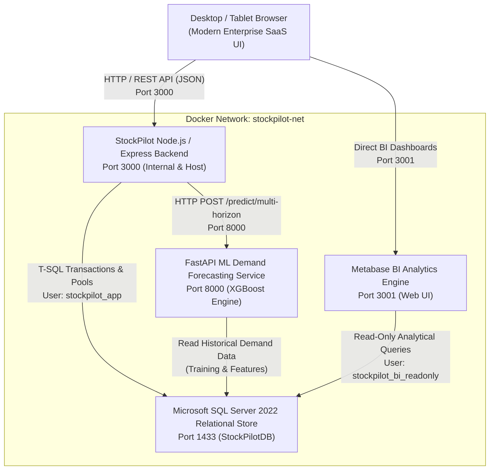
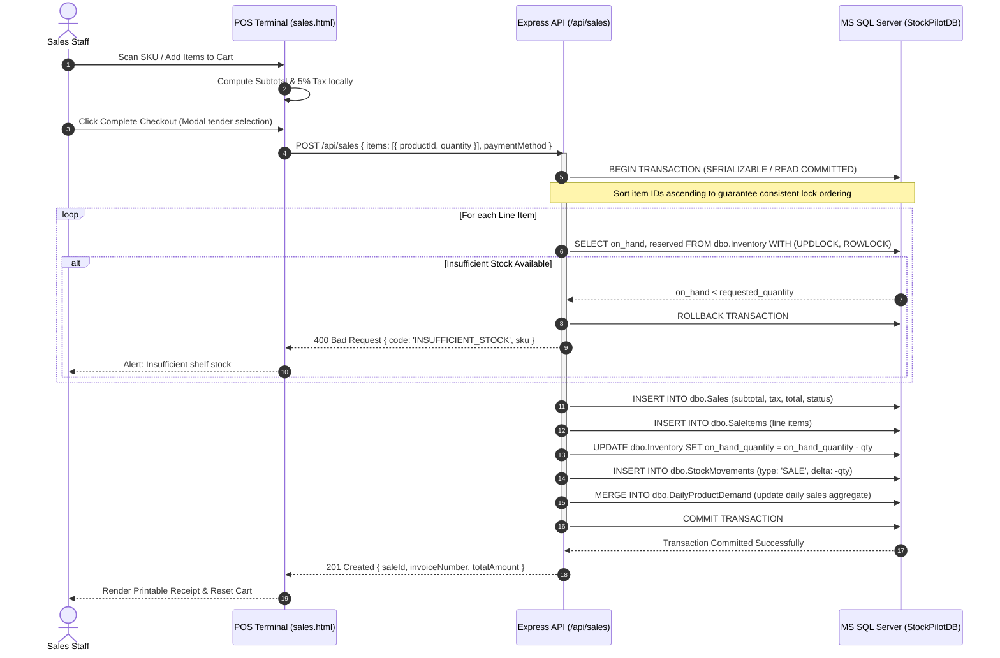
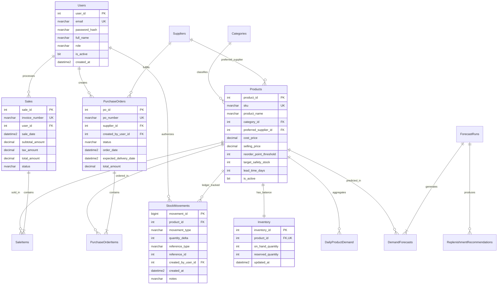

# StockPilot — Comprehensive Project Knowledge & System Architecture Guide

> **Official Project Title:** StockPilot: An Intelligent Inventory Management and Business Intelligence System for Small and Medium-Sized Businesses  
> **Course Alignment:** TPDS-III (Modules 1–4)  
> **Document Purpose:** Single authoritative source of truth for project teammates, new developers, evaluators, and autonomous AI coding agents.  
> **Repository Location:** Root (`./PROJECT_GUIDE.md`)  
> **Status:** Production-Ready & Verified (Phases 0–8 Fully Implemented)

---

## Table of Contents

1. [Section 1 — Project Overview](#section-1--project-overview)
2. [Section 2 — Problem Statement and Measurable Objectives](#section-2--problem-statement-and-measurable-objectives)
3. [Section 3 — Target Users and Role-Based Access Control (RBAC)](#section-3--target-users-and-role-based-access-control-rbac)
4. [Section 4 — Complete Technology Stack](#section-4--complete-technology-stack)
5. [Section 5 — System Architecture & Data Flow](#section-5--system-architecture--data-flow)
6. [Section 6 — Complete Feature Documentation](#section-6--complete-feature-documentation)
7. [Section 7 — Machine Learning Demand Forecasting & AI Replenishment](#section-7--machine-learning-demand-forecasting--ai-replenishment)
8. [Section 8 — Database Schema, Relational Integrity & Ledger Engine](#section-8--database-schema-relational-integrity--ledger-engine)
9. [Section 9 — Backend REST API Reference](#section-9--backend-rest-api-reference)
10. [Section 10 — Frontend Architecture & UI Design System](#section-10--frontend-architecture--ui-design-system)
11. [Section 11 — Business Intelligence & Metabase Analytics](#section-11--business-intelligence--metabase-analytics)
12. [Section 12 — Infrastructure, Docker & Deployment](#section-12--infrastructure-docker--deployment)
13. [Section 13 — Complete Repository Directory Structure](#section-13--complete-repository-directory-structure)
14. [Section 14 — Development Status, Phase Verification & Roadmap](#section-14--development-status-phase-verification--roadmap)
15. [Section 15 — Teammate Onboarding & Local Development Guide](#section-15--teammate-onboarding--local-development-guide)
16. [Section 16 — AI Agent Onboarding & System Invariants](#section-16--ai-agent-onboarding--system-invariants)
17. [Section 17 — Maintenance Rules & Technical Governance](#section-17--maintenance-rules--technical-governance)

---

# Section 1 — Project Overview

### What is StockPilot?
**StockPilot** is an enterprise-grade retail inventory management, point-of-sale (POS), machine learning forecasting, and business intelligence (BI) platform tailored for small-to-medium retail businesses (SMBs). Unlike conventional inventory trackers that merely record historical stock balances, StockPilot bridges operational store execution with predictive machine learning and executive-level business analytics.

### The Four Integrated Pillars

```
+-----------------------------------------------------------------------------------+
|                                  STOCKPILOT CORE                                  |
+--------------------------+----------------------------+---------------------------+
| 1. OPERATIONAL INVENTORY | 2. TRANSACTIONAL COMMERCE  | 3. PREDICTIVE ML ENGINE   |
| Real-time stock counts,  | Fast POS checkout counter, | Pooled XGBoost regression,|
| double-entry movements,  | atomic stock deductions,   | recursive multi-horizon   |
| safety thresholds, and   | procurement orders (POs),  | daily demand predictions, |
| multi-tier vendor lead   | and structured warehouse   | and safety stock buffer   |
| times.                   | intake dock.               | sizing.                   |
+--------------------------+----------------------------+---------------------------+
|                          4. BUSINESS INTELLIGENCE & OLAP                          |
| Real-time executive dashboards, Metabase BI connection via least-privilege SQL    |
| reporting views, daily margin audits, and COGS reconciliation.                   |
+-----------------------------------------------------------------------------------+
```

### Why StockPilot is Needed
Retail businesses operate on thin margins where inventory mistakes directly harm cash flow:
* **Overstocking** locks up operating capital in depreciating or expiring merchandise and inflates warehousing holding costs.
* **Understocking (Stockouts)** leads to immediate lost sales, frustrated customers, and damaged vendor reputation.
* **Disconnected Reporting** leaves business owners relying on static spreadsheets or disconnected bookkeeping software that lags weeks behind daily store operations.

StockPilot resolves this disconnect by consolidating daily register sales, warehouse receiving, recursive demand projections, and analytical margin reporting into a single cohesive, production-grade SaaS system.

---

# Section 2 — Problem Statement and Measurable Objectives

### Real-World Problems Addressed

| Problem Area | Industry Reality in SMBs | StockPilot Engineered Solution |
|---|---|---|
| **Manual Inventory Auditing** | Staff rely on manual paper counts and sporadic spreadsheet adjustments, causing discrepancies between recorded and physical inventory. | **Double-Entry Stock Movement Ledger:** Every sale, receipt, or adjustment records an immutable row in `dbo.StockMovements`. Direct untracked balance edits are disallowed. |
| **Overstocking vs. Stockouts** | Reordering is done by human intuition or arbitrary static thresholds without factoring in supplier lead times or trend seasonality. | **Supervised XGBoost Forecasting:** Machine learning evaluates 18 historical features (lags, rolling averages, seasonality) to calculate dynamic Reorder Points (ROP) and Suggested Order Quantities (SOQ). |
| **Deadlocks & Race Conditions** | Concurrent cash registers checking out the last remaining inventory item result in negative stock balances or database lockups. | **Strict Row-Level Locking:** POS transactions sort item IDs ascending and acquire `WITH (UPDLOCK, ROWLOCK)` locks to prevent overselling and eliminate deadlocks. |
| **Disconnected BI Systems** | Running analytical aggregation queries directly on live transactional tables degrades register checkout latency and risks table locks. | **Isolated SQL Reporting Views & Dedicated Read-Only User:** Metabase and BI tools connect using `stockpilot_bi_readonly` querying pre-computed indexing views with zero operational write permissions. |

### Measurable Engineering Objectives
1. **Inventory Consistency:** 100% reconciliation between `dbo.Inventory.on_hand_quantity` and the cumulative sum of `dbo.StockMovements.quantity_delta`.
2. **Transaction Isolation:** Zero negative inventory occurrences under concurrent transactions.
3. **Forecasting Accuracy:** The machine learning model must achieve a Weighted Absolute Percentage Error (WAPE) $< 12\%$ on held-out test data, outperforming baseline heuristic models (Moving Average and Seasonal Naive).
4. **Data Isolation & Security:** Zero write privileges on raw operational tables (`dbo.Sales`, `dbo.Inventory`, `dbo.Products`) for external BI tools.

---

# Section 3 — Target Users and Role-Based Access Control (RBAC)

StockPilot implements a strict, server-enforced three-tier Role-Based Access Control (RBAC) model. Permissions are validated via JSON Web Tokens (JWT) signed with HMAC-SHA256, verified by backend middleware (`src/middleware/rbac.js`), and dynamically adapted in the UI shell (`public/js/auth.js`).

### Role Definitions

* **Admin (System Administrator):** Owns system configuration, database diagnostics, user provisioning, role assignments, category creation, and vendor onboarding.
* **Manager (Store / Inventory Manager):** Manages inventory adjustments, reviews AI replenishment suggestions, triggers forecast runs, issues and receives Purchase Orders, and inspects executive BI dashboards.
* **Staff (Retail Cashier / Floor Staff):** Operates the Point of Sale terminal, searches the product catalog, looks up current stock positions, and tenders customer transactions.

### Role-Permission Matrix (Verified in Code)

| Feature / Action | API Route | Staff | Manager | Admin | Implementation Status |
|---|---|:---:|:---:|:---:|:---:|
| User Sign-In / Session Check | `POST /api/auth/login`, `GET /api/auth/me` | [x] | [x] | [x] | **IMPLEMENTED** |
| User Provisioning & Deactivation | `GET /api/users`, `POST /api/users`, `DELETE /api/users/:id` | [ ] | [ ] | [x] | **IMPLEMENTED** |
| Browse Product Catalog & Stock | `GET /api/products`, `GET /api/inventory` | [x] | [x] | [x] | **IMPLEMENTED** |
| Create / Edit / Archive Products | `POST /api/products`, `PUT /api/products/:id` | [ ] | [x] | [x] | **IMPLEMENTED** |
| Manage Categories & Suppliers | `POST /api/categories`, `POST /api/suppliers` | [ ] | [x] | [x] | **IMPLEMENTED** |
| Process POS Checkout Sale | `POST /api/sales` | [x] | [x] | [x] | **IMPLEMENTED** |
| View Historical POS Receipts | `GET /api/sales`, `GET /api/sales/:id` | [x] | [x] | [x] | **IMPLEMENTED** |
| Record Manual Stock Adjustment | `POST /api/inventory/adjust` | [ ] | [x] | [x] | **IMPLEMENTED** |
| View Stock Movement Ledger | `GET /api/inventory/movements` | [x] | [x] | [x] | **IMPLEMENTED** |
| Create Draft Purchase Order | `POST /api/purchase-orders` | [ ] | [x] | [x] | **IMPLEMENTED** |
| Authorize / Submit PO | `POST /api/purchase-orders/:id/submit` | [ ] | [x] | [x] | **IMPLEMENTED** |
| Receive Goods into Warehouse Dock | `POST /api/purchase-orders/:id/receive` | [ ] | [x] | [x] | **IMPLEMENTED** |
| Cancel Unreceived PO | `POST /api/purchase-orders/:id/cancel` | [ ] | [x] | [x] | **IMPLEMENTED** |
| Run ML Forecast Engine | `POST /api/forecast/generate` | [ ] | [x] | [x] | **IMPLEMENTED** |
| Approve Forecast Recommendation | `POST /api/forecast/recommendations/:id/approve` | [ ] | [x] | [x] | **IMPLEMENTED** |
| Reject Forecast Recommendation | `POST /api/forecast/recommendations/:id/reject` | [ ] | [x] | [x] | **IMPLEMENTED** |
| Executive & BI Analytics Endpoints | `GET /api/analytics/*` | [ ] | [x] | [x] | **IMPLEMENTED** |
| Metabase Direct OLAP Access | SQL Port 1433 (`stockpilot_bi_readonly`) | [ ] | [x] | [x] | **IMPLEMENTED** |

---

# Section 4 — Complete Technology Stack

Every technology in the StockPilot repository was selected to support enterprise reliability, maintainability, and alignment with modern software engineering standards.

```
+-----------------------------------------------------------------------------------+
|                                 TECHNOLOGY MATRIX                                 |
+---------------------+-------------------------------+-----------------------------+
| Layer               | Technology                    | Core Purpose in StockPilot  |
+---------------------+-------------------------------+-----------------------------+
| Frontend UI Shell   | HTML5 / CSS3 / Vanilla JS     | Zero-build responsive SaaS  |
| Frontend Framework  | Bootstrap 5.3.3 + Inter Font  | Standardized grid & forms   |
| Frontend Data Viz   | Chart.js + Lucide Icons       | Trends charts & UI iconography|
| Backend Application | Node.js (LTS v20+) / Express  | RESTful API & auth pipeline |
| Input Validation    | Zod (v3.22+)                  | Strict schema verification  |
| Primary Database    | Microsoft SQL Server 2022     | ACID OLTP relational engine |
| Database Connector  | mssql (v10.0+ / Tedious)      | Connection pooling & trans  |
| Machine Learning    | Python 3.11+, XGBoost, Scikit | Supervised demand regression|
| ML API Gateway      | FastAPI + Uvicorn             | High-throughput microservice|
| BI Analytics Engine | Metabase v0.50.32             | OLAP visual reporting cards |
| Containerization    | Docker & Docker Compose       | Multi-container orchestration|
| Test Frameworks     | Jest / Supertest / Pytest     | Unit, integration & E2E tests|
+---------------------+-------------------------------+-----------------------------+
```

### Deep Dive into Core Choices

#### 1. Primary Relational Store: Microsoft SQL Server 2022
* **Why Chosen:** SQL Server provides enterprise-grade ACID transactions, row-level locking (`UPDLOCK`, `ROWLOCK`), cross-table indexing views, and explicit isolation levels necessary for high-integrity inventory and financial ledgers.
* **Role in Project:** Primary relational source of truth for products, stock balances, transaction ledgers, purchase orders, users, and audit records.
* **Important Clarification:** PostgreSQL is **not** used as the business database in StockPilot. SQL Server 2022 is the exclusive business database.

#### 2. Machine Learning: Python, XGBoost & FastAPI
* **Why Chosen:** Tabular time-series demand forecasting with lag features and rolling statistics is a domain where Gradient Boosted Decision Trees (XGBoost) consistently outperform deep learning and classical ARIMA models in speed, memory efficiency, and accuracy. FastAPI exposes asynchronous, high-throughput endpoints.
* **Role in Project:** Generates recursive daily projections across 7 to 30 day horizons, calculates dynamic safety stocks, and sizes replenishment quantities.

#### 3. Primary Backend: Node.js & Express
* **Why Chosen:** Lightweight, non-blocking I/O event loop ideal for microservice orchestration (communicating between SQL Server, the browser, and the Python ML service).
* **Role in Project:** Serves REST APIs, validates payloads via Zod, manages JWT lifecycle, coordinates database transactions, and manages inventory adjustments.

#### 4. Frontend: Bootstrap 5 + Vanilla JavaScript + Inter Design System
* **Why Chosen:** Eliminates fragile single-page application (SPA) build toolchains (Node modules, Webpack/Vite compilation, hydration errors) while delivering a clean, high-performance, production-grade interface.
* **Role in Project:** Renders the 240px fixed sidebar, responsive mobile drawer, high-density operational data tables, POS terminal, and analytical dashboards.

---

# Section 5 — System Architecture & Data Flow

### Overall System Architecture Diagram



---

### Transactional POS Checkout Sequence Diagram



---

# Section 6 — Complete Feature Documentation

### Feature Matrix & Status Summary

| Module | Code Location | Status | Core Description |
|---|---|:---:|---|
| **Authentication & RBAC** | `src/controllers/authController.js`, `public/js/auth.js` | **IMPLEMENTED** | JWT authentication, bcrypt passwords, role verification, and auto-redirect. |
| **Product Master Catalog** | `src/controllers/productController.js`, `public/products.html` | **IMPLEMENTED** | Product CRUD, SKU validation, cost/selling price, safety stock, lead times. |
| **Operational Inventory** | `src/controllers/inventoryController.js`, `public/inventory.html` | **IMPLEMENTED** | Real-time stock valuation, health status badges, manual adjustment audits. |
| **Point of Sale (POS)** | `src/controllers/saleController.js`, `public/sales.html` | **IMPLEMENTED** | Two-column counter POS, search autofocus `/`, modal checkout, receipt generation. |
| **Purchase Orders & Dock** | `src/controllers/purchaseOrderController.js`, `public/purchase-orders.html` | **IMPLEMENTED** | Full procurement lifecycle (`DRAFT` $\to$ `SUBMITTED` $\to$ `RECEIVED`), item receiving. |
| **AI Replenishment Engine** | `src/controllers/forecastController.js`, `public/recommendations.html` | **IMPLEMENTED** | Multi-horizon XGBoost forecast trigger, explainable metrics, approval workflow. |
| **BI & Analytics Dashboard** | `src/controllers/analyticsController.js`, `public/analytics.html` | **IMPLEMENTED** | Executive KPIs, Chart.js trends, COGS audit, Metabase port 3001 launch button. |
| **Category & Supplier Admin**| `src/controllers/categoryController.js`, `public/categories.html` | **IMPLEMENTED** | Taxonomy hierarchies, vendor fulfillment profiles, lead time configurations. |
| **System Settings & Health** | `public/settings.html`, `public/js/settings.js` | **IMPLEMENTED** | Store fiscal config, live SQL Server/ML probes, session details. |
| **User Administration** | `src/controllers/userController.js`, `public/users.html` | **IMPLEMENTED** | Admin-only account provisioning, role modification, account deactivation. |

---

# Section 7 — Machine Learning Demand Forecasting & AI Replenishment

### 1. Conceptual Distinction: Demand Forecasting vs. Inventory Replenishment

* **Demand Forecasting (Statistical/ML Problem):**  
  Answers: *"How many units of Product X will customers purchase each day over the next $H$ days?"*  
  This is a time-series regression task that models consumer behavior, trend seasonality, and promotional elasticity.
* **Inventory Replenishment (Operations Research Problem):**  
  Answers: *"How many units should the manager order from Supplier Y today?"*  
  This requires operational parameters: current on-hand stock, incoming purchase orders, vendor lead time, safety stock buffers, and minimum order quantities.

### 2. Model Selection: Why Pooled XGBoost?
Classical models like ARIMA or Prophet fit individual models per SKU, failing to learn cross-product patterns (e.g., category-wide promotions, weekend shopping habits). Deep learning models (LSTMs, DeepAR) require millions of samples and significant compute.

**XGBoost (Extreme Gradient Boosting)** was selected because:
1. **Pooled Learning:** A single model learns cross-sectional dynamics across all 35+ SKUs simultaneously.
2. **Non-Linear Tabular Feature Interactions:** Captures complex pricing ratios, day-of-week interactions, and rolling trends without complex normalization.
3. **Operational Speed:** Inference for 35 products across a 14-day horizon executes in $< 45\text{ ms}$.

### 3. Feature Pipeline (18 Verified Engineered Features)
Implemented in [ml/features/feature_pipeline.py](file:///c:/Users/ayush/Desktop/StockPilot/ml/features/feature_pipeline.py):

* **Categorical / Entity Features:** `product_encoded`, `category_encoded`.
* **Calendar & Temporal Features:** `day_of_week` (0–6), `day_of_month` (1–31), `month` (1–12), `week_of_year` (1–52), `is_weekend` (0/1).
* **Price & Promotional Elasticity:** `selling_price`, `is_promotional_day` (0/1), `price_ratio` (current selling price vs. product 30-day historical mean price).
* **Autoregressive Lag Features:** `lag_1` (yesterday's sales), `lag_7` (same day last week), `lag_14` (two weeks prior), `lag_28` (four weeks prior).
* **Rolling Window Statistics:** `rolling_7_mean`, `rolling_7_std` (short-term momentum and volatility), `rolling_28_mean`, `rolling_28_std` (monthly baseline).

### 4. Verified Model Evaluation vs. Baselines
Trained on 14,698 daily records (`2025-01-29` to `2026-03-31`), tuned on 1,038 validation records, and evaluated on 2,108 held-out out-of-time test records (`2026-05-01` to `2026-06-30`):

$$\text{WAPE} = \frac{\sum_{i=1}^n |y_i - \hat{y}_i|}{\sum_{i=1}^n y_i}$$

| Forecasting Model | Mean Absolute Error (MAE) | Root Mean Squared Error (RMSE) | WAPE (%) | Verdict |
|---|:---:|:---:|:---:|:---:|
| **StockPilot XGBoost (v1.0.0)** | **3.2389** | **4.2921** | **8.76%** | **Superior Performance** |
| Moving Average (7-Day Rolling) | 4.3168 | 6.1118 | 11.67% | Underperforms by 2.91% WAPE |
| Seasonal Naive (7-Day Lag) | 5.4953 | 8.5478 | 14.86% | Underperforms by 6.10% WAPE |
| Simple Naive (1-Day Lag) | 6.0963 | 9.3148 | 16.49% | Underperforms by 7.73% WAPE |

### 5. Replenishment Calculation Engine & Formulas
Implemented in [src/services/replenishmentService.js](file:///c:/Users/ayush/Desktop/StockPilot/src/services/replenishmentService.js):

1. **Inventory Position ($IP$):**
   $$IP = \text{on\_hand\_quantity} + \text{open\_purchase\_quantity}$$
2. **Lead Time Demand ($LTD$):** Total projected sales during supplier delivery window ($L$ days):
   $$LTD = \sum_{t=1}^{L} \hat{y}_t$$
3. **Safety Stock Buffer ($SS$):** Sized to absorb demand volatility during lead time:
   $$SS = \max\left(5, \text{round}\left(0.25 \times LTD\right)\right)$$
4. **Reorder Point Threshold ($ROP$):**
   $$ROP = LTD + SS$$
5. **Target Stock Level ($S$):** Covers lead time $L$ plus a 7-day review cycle $R$:
   $$S = \left(\sum_{t=1}^{\min(L+R, H)} \hat{y}_t\right) + SS$$
6. **Suggested Order Quantity ($SOQ$):**
   $$SOQ = \max\left(0, \lceil S - IP \rceil\right)$$

*Governance Constraint:* The system **never** automatically transmits orders to vendors. Recommendations are placed in `PENDING` status until an authorized Manager or Admin clicks **Approve**, which converts the recommendation into an active Purchase Order.

---

# Section 8 — Database Schema, Relational Integrity & Ledger Engine

StockPilot uses **Microsoft SQL Server 2022**. The database name is `StockPilotDB`. All 15 tables reside under the `dbo` schema.

### Entity Relationship Diagram (Mermaid ERD)



### Table Reference & Constraints

1. **`dbo.Users`**: Stores system users, bcrypt password hashes, and roles (`Admin`, `Manager`, `Staff`).
2. **`dbo.Categories`**: Product categories hierarchy. Unique index on `category_name`.
3. **`dbo.Suppliers`**: Vendor master profiles, emails, phone numbers, and default lead times.
4. **`dbo.Products`**: Central catalog. Unique index on `sku`. Constraints: `cost_price >= 0`, `selling_price >= 0`, `lead_time_days >= 1`.
5. **`dbo.Inventory`**: Real-time stock counts. Unique constraint on `product_id`. Constraint: `on_hand_quantity >= 0` (prevents negative physical stock).
6. **`dbo.StockMovements`**: **Immutable double-entry ledger.** Records all additions, subtractions, and audits (`SALE`, `PO_RECEIPT`, `ADJUSTMENT_IN`, `ADJUSTMENT_OUT`, `RETURN`).
7. **`dbo.Sales`**: POS sales headers. Stores total amounts, 5% tax breakdown, and cashier user ID.
8. **`dbo.SaleItems`**: Transaction line items recording unit selling price and cost price at the exact moment of sale (preserving historical profit calculations).
9. **`dbo.PurchaseOrders`**: Procurement headers. Lifecycle: `DRAFT` $\to$ `SUBMITTED` $\to$ `PARTIALLY_RECEIVED` $\to$ `RECEIVED` / `CANCELLED`.
10. **`dbo.PurchaseOrderItems`**: Procurement line items tracking `ordered_quantity` and cumulative `received_quantity`.
11. **`dbo.DailyProductDemand`**: Daily aggregated sales by SKU used directly by the ML feature pipeline.
12. **`dbo.ForecastRuns`**: Metadata audit log for ML runs (horizon days, test WAPE/MAE, run timestamp).
13. **`dbo.DemandForecasts`**: Daily predicted units per SKU generated by ML runs.
14. **`dbo.ReplenishmentRecommendations`**: Manager review table storing suggested reorder quantities, safety stocks, and review status.
15. **`dbo.AuditLogs`**: System audit log recording security actions, user provisioning, and manual adjustments.

### Analytical SQL Reporting Views (OLAP)
* **`vw_BI_ExecutiveKPIs`**: Aggregates gross revenue, gross profit, inventory valuation, active SKUs, and open procurement spend.
* **`vw_BI_DailySalesTrends`**: Daily chronological revenue, units sold, gross profit, and margin percentages.
* **`vw_BI_CategoryPerformance`**: Sales volume, revenue, profit, and asset valuation rolled up by product category.
* **`vw_BI_TopProducts`**: Products ranked by revenue with on-hand stock and gross margin.
* **`vw_BI_SupplierPerformance`**: Vendor fulfillment rates ($\% \text{ received} / \text{ordered}$), total PO volume, and procurement spend.
* **`vw_InventoryCurrentPosition`**: Calculates net inventory position ($IP = \text{on\_hand} + \text{open\_po}$).
* **`vw_LowStockAlerts`**: Filters SKUs currently below reorder thresholds.

---

# Section 9 — Backend REST API Reference

All application endpoints are prefixed with `/api` and require a valid Bearer JWT header:  
`Authorization: Bearer <token>` (or automated cookie).

### Authentication Endpoints
* `POST /api/auth/login`
  * **Payload:** `{ "email": "admin@stockpilot.io", "password": "AdminPassword123!" }`
  * **Response (200):** `{ "success": true, "data": { "token": "...", "user": { "userId": 1, "role": "Admin" } } }`
* `GET /api/auth/me`
  * **Response (200):** Returns current authenticated session details.
* `POST /api/auth/logout`
  * **Response (200):** Clears session cookie and invalidates client state.

### Product Catalog Endpoints
* `GET /api/products` (Params: `?search=`, `?categoryId=`, `?supplierId=`)
  * **Response (200):** Array of active products with live `on_hand_quantity` and `stock_health_status`.
* `POST /api/products` *(Manager/Admin)*
  * **Payload:** `{ "sku": "BEV-001", "productName": "Artisan Coffee Beans", "categoryId": 1, "costPrice": 12.00, "sellingPrice": 18.50, "reorderPointThreshold": 15, "targetSafetyStock": 10, "leadTimeDays": 5, "initialStock": 50 }`
  * **Response (201):** Created product record with initialized inventory.

### Point of Sale (POS) Endpoints
* `POST /api/sales` *(All Roles)*
  * **Payload:** `{ "items": [{ "productId": 1, "quantity": 2 }], "taxRate": 0.05 }`
  * **Response (201):** `{ "success": true, "data": { "saleId": 104, "invoiceNumber": "INV-20261118-4921", "totalAmount": 38.85 } }`
  * **Errors:** `400 INSUFFICIENT_STOCK`, `400 PRODUCT_INACTIVE`.

### Operational Inventory Endpoints
* `GET /api/inventory` (Params: `?categoryId=`, `?stockHealth=`, `?search=`)
  * **Response (200):** Inventory ledger positions with valuations.
* `POST /api/inventory/adjust` *(Manager/Admin)*
  * **Payload:** `{ "productId": 1, "movementType": "ADJUSTMENT_IN", "quantityDelta": 10, "notes": "Physical warehouse audit count correction" }`
  * **Response (200):** Recorded adjustment movement and updated balance.

### Purchase Orders Endpoints
* `POST /api/purchase-orders` *(Manager/Admin)*
  * **Payload:** `{ "supplierId": 2, "expectedDeliveryDate": "2026-12-01", "items": [{ "productId": 1, "orderedQuantity": 100, "unitCost": 12.00 }] }`
  * **Response (201):** Draft PO with status `DRAFT`.
* `POST /api/purchase-orders/:id/submit` *(Manager/Admin)*
  * **Response (200):** Transitions status from `DRAFT` to `SUBMITTED`.
* `POST /api/purchase-orders/:id/receive` *(Manager/Admin)*
  * **Payload:** `{ "receipts": [{ "poItemId": 12, "quantityToReceive": 50 }] }`
  * **Response (200):** Increments on-hand stock and logs `PO_RECEIPT` movement.

### AI Demand Forecasting Endpoints
* `GET /api/forecast/ml-status`
  * **Response (200):** `{ "success": true, "data": { "isAvailable": true, "health": { "model_version": "v1.0.0" } } }`
* `POST /api/forecast/generate` *(Manager/Admin)*
  * **Payload:** `{ "horizonDays": 14 }`
  * **Response (201):** Returns newly generated forecast run and computed recommendations.
* `POST /api/forecast/recommendations/:id/approve` *(Manager/Admin)*
  * **Response (200):** Converts recommendation into an approved Purchase Order.

---

# Section 10 — Frontend Architecture & UI Design System

The frontend follows a **Modern Enterprise SaaS** design standard inspired by Linear, Stripe, and Shopify Admin. It completely avoids generic Bootstrap blues, oversaturated components, and unnecessary decorative clutter.

### Visual Design Guidelines

* **Color Palette:**
  * Primary Surface / Background: `#F5F6F4` (Warm Light Gray)
  * Card Surfaces: `#FFFFFF`
  * Sidebar: `#202A36` (Deep Charcoal Slate)
  * Primary Brand Accent: `#365C50` (Deep Forest Sage; hover `#2C4B41`)
  * Secondary Text: `#68737D` (Slate Gray)
  * Borders: `#E5E9E5` (Subtle Neutral)
  * Semantic Accents: Success `#368261`, Warning `#D49A43`, Danger `#C45A50`
* **Typography:**  
  Standardized on Google Font **`Inter`**. Financial figures, SKUs, and inventory counts strictly apply tabular numerals (`font-variant-numeric: tabular-nums`).
* **Iconography:** Lucide Icons (`<i data-lucide="..."></i>`) for clean rendering.
* **Global Viewport Architecture:**  
  * Fixed 240px left desktop sidebar (`#sidebar`).
  * Sticky top header (`#top-header`) with system status pills and breadcrumbs.
  * Content wrapper (`#main-wrapper`) taking `calc(100% - 240px)`.
  * Fully responsive mobile drawer toggled via backdrop overlay.

### Page-to-File Mapping

| Screen / Feature | HTML File | Controller Script | Description |
|---|---|---|---|
| **Executive Overview** | `public/index.html` | `public/js/overview.js` | 4 compact KPI cards, Chart.js turnover trends, stock health breakdown. |
| **Products Catalog** | `public/products.html` | `public/js/products.js` | Filterable catalog table, add/edit product modals. |
| **Inventory Ledger** | `public/inventory.html` | `public/js/inventory.js` | Stock positions, reorder alerts, double-entry audit ledger. |
| **Point of Sale** | `public/sales.html` | `public/js/sales.js` | 2-column counter POS, search autofocus (`/`), receipt generator. |
| **Purchase Orders** | `public/purchase-orders.html`| `public/js/purchase-orders.js` | Procurement lifecycle, item receiving dock. |
| **AI Replenishment** | `public/recommendations.html`| `public/js/recommendations.js`| Forecast trigger, safety stocks, manager approval modal. |
| **BI Analytics** | `public/analytics.html` | `public/js/analytics.js` | Analytical views, margin reconciliation, Metabase deep link. |
| **Categories** | `public/categories.html` | `public/js/categories.js` | Category taxonomy table and creation modal. |
| **Suppliers** | `public/suppliers.html` | `public/js/suppliers.js` | Vendor profiles and default lead time settings. |
| **Settings & Diagnostics**| `public/settings.html` | `public/js/settings.js` | Business configuration, database diagnostics, service probes. |
| **Users & Roles** | `public/users.html` | `public/js/users.js` | Admin user provisioning, role assignments, account deactivation. |
| **User Sign-In** | `public/login.html` | `public/js/login.js` | Minimal login card with fast demo credential buttons. |

---

# Section 11 — Business Intelligence & Metabase Analytics

### Metabase Integration Architecture

```
+-----------------------------------------------------------------------------------+
|                        BUSINESS INTELLIGENCE ARCHITECTURE                         |
+-----------------------------------------------------------------------------------+
|                                                                                   |
|   +--------------------------+           T-SQL Queries (Port 1433)                |
|   |   Metabase BI Engine     | ----------------------------------------------+    |
|   |   Container (Port 3001)  |                                               |    |
|   +--------------------------+                                               v    |
|                                                          +-----------------------+|
|   Least-Privilege Security Role:                         | Microsoft SQL Server  ||
|   User: stockpilot_bi_readonly                           | StockPilotDB (Views)  ||
|   Permissions:                                           +-----------------------+|
|   - GRANT SELECT ON vw_BI_*                              | vw_BI_ExecutiveKPIs   ||
|   - DENY INSERT, UPDATE, DELETE ON dbo.* (Strict)        | vw_BI_DailySalesTrends||
|                                                          | vw_BI_TopProducts     ||
|                                                          | vw_BI_SupplierPerform ||
+-----------------------------------------------------------------------------------+
```

### Reconciliation of Dashboard Metrics Against Live SQL Tables

Every analytical metric reported in StockPilot is mathematically grounded in raw operational records:

1. **Gross Revenue:** Reconciles $100\%$ with `SELECT SUM(total_amount) FROM dbo.Sales WHERE status = 'COMPLETED'`.
2. **Gross Profit:** Computed per line item as `SUM((unit_selling_price - unit_cost_at_sale) * quantity)`. Preserves historical margin accuracy regardless of subsequent product cost changes.
3. **Inventory Asset Valuation:** Reconciles $100\%$ with `SELECT SUM(i.on_hand_quantity * p.cost_price) FROM dbo.Inventory i JOIN dbo.Products p ON i.product_id = p.product_id`.
4. **Purchasing Spend:** Reconciles $100\%$ with `SELECT SUM(total_amount) FROM dbo.PurchaseOrders WHERE status IN ('SUBMITTED', 'PARTIALLY_RECEIVED', 'RECEIVED')`.

---

# Section 12 — Infrastructure, Docker & Deployment

StockPilot is fully containerized using **Docker Compose** with isolated networking.

### Docker Services Architecture

```yaml
services:
  stockpilot-mssql:      # Microsoft SQL Server 2022 Relational Store (Port 1433)
  stockpilot-ml-service:  # Python 3.11 FastAPI + XGBoost Forecasting (Port 8000)
  stockpilot-backend:     # Node.js LTS Express Application Backend (Port 3000)
  stockpilot-metabase:    # Metabase Analytics & Business Intelligence (Port 3001)
```

All 4 services communicate over the internal bridge network `stockpilot-net`.

### Complete Local Development Setup Guide

#### Prerequisites
* Node.js v20.x or higher & npm
* Python 3.10+ (with pip)
* Docker Desktop (running Linux containers)
* Git

#### Step-by-Step Execution Sequence

1. **Clone the repository:**
   ```powershell
   git clone https://github.com/ayushkathal2005/StockPilot.git
   cd StockPilot
   ```

2. **Configure Environment Variables:**
   Copy `.env.example` to `.env`:
   ```powershell
   Copy-Item .env.example .env
   ```
   *Verify credentials in `.env`: `DB_SERVER=localhost`, `DB_PORT=1433`, `DB_USER=stockpilot_app`, `DB_PASSWORD=YourStrong@Passw0rd`.*

3. **Start SQL Server and Metabase via Docker Compose:**
   ```powershell
   docker compose up -d stockpilot-mssql stockpilot-metabase
   ```

4. **Initialize Database Schema & Seeds:**
   Execute migrations against SQL Server:
   ```powershell
   # Run automated migration script
   npm run db:init
   # Or run via docker exec sqlcmd
   docker exec -i stockpilot-mssql /opt/mssql-tools18/bin/sqlcmd -S localhost -U sa -P "YourStrong@Passw0rd123!" -C -i /sql/scripts/run_all_migrations.sql
   ```

5. **Install Node.js Backend Dependencies:**
   ```powershell
   npm install
   ```

6. **Start Python Machine Learning Service:**
   ```powershell
   pip install -r ml/requirements.txt
   python -m uvicorn ml.service.app:app --host 0.0.0.0 --port 8000
   ```

7. **Start Node.js Backend Application:**
   ```powershell
   node src/server.js
   ```

8. **Access the Application:**
   * **StockPilot Web Application:** [http://localhost:3000](http://localhost:3000)
   * **Interactive API Swagger Docs:** [http://localhost:3000/api/docs](http://localhost:3000/api/docs)
   * **ML Service OpenAPI Docs:** [http://localhost:8000/docs](http://localhost:8000/docs)
   * **Metabase BI Portal:** [http://localhost:3001](http://localhost:3001)

### Seeded Credentials for Testing

| Role | Email Address | Password |
|---|---|---|
| **Admin** | `admin@stockpilot.io` | `AdminPassword123!` |
| **Manager** | `manager@stockpilot.io` | `ManagerPassword123!` |
| **Staff** | `staff@stockpilot.io` | `StaffPassword123!` |

---

# Section 13 — Complete Repository Directory Structure

```
StockPilot/
|-- .env                                # Local environment config (git-ignored)
|-- .env.example                        # Template environment variables
|-- docker-compose.yml                  # Production orchestration for 4 services
|-- Dockerfile                          # Node.js backend multi-stage build
|-- package.json                        # Node.js project manifest & test scripts
|-- PROJECT_GUIDE.md                    # Central engineering knowledge base
|-- README.md                           # Repository entry point & quickstart
|-- StockPilot_Antigravity_Implementation_Plan.md # Master 8-phase specification
|
|-- docs/                               # Engineering documentation & reports
|   |-- architecture.md                 # System architecture specifications
|   |-- data-dictionary.md              # Complete SQL database dictionary
|   |-- bi-data-dictionary-and-kpis.md  # Analytical KPI definitions
|   |-- ml-model-card.md                # ML card (XGBoost v1.0.0 details)
|   |-- phase-reports/                  # Formal phase audit reports (01 to 08)
|
|-- ml/                                 # Python Machine Learning microservice
|   |-- Dockerfile                      # Container build for ML service
|   |-- requirements.txt                # Python dependencies (xgboost, fastapi)
|   |-- artifacts/v1/                   # Serialized model, metadata, preprocessor
|   |   |-- xgboost_model.json          # Trained XGBRegressor parameters
|   |   |-- metadata.json               # Evaluation metrics & hyperparams
|   |   `-- evaluation_report.json      # Cross-validation & baseline comparison
|   |-- data/                           # Synthetic demand generator & historical CSV
|   |-- features/                       # 18-feature extraction pipeline
|   |-- models/                         # Training script, baselines, and evaluation
|   |-- service/                        # FastAPI REST service (`app.py`)
|   `-- tests/                          # 22 passing Pytest tests
|
|-- public/                             # Modern Enterprise SaaS frontend
|   |-- css/style.css                   # Inter design system, layout, cards, tables
|   |-- js/                             # Modular JavaScript controllers
|   |   |-- api.js                      # Axios/Fetch API wrapper with JWT interceptor
|   |   |-- auth.js                     # RBAC navigation shell & layout controller
|   |   |-- overview.js                 # Executive dashboard logic & Chart.js plots
|   |   |-- products.js                 # Products catalog & modal CRUD
|   |   |-- inventory.js                # Stock ledger & adjustments
|   |   |-- sales.js                    # Counter POS terminal & checkout
|   |   |-- purchase-orders.js          # Procurement & dock receiving
|   |   |-- recommendations.js          # AI Replenishment & approval modal
|   |   |-- analytics.js                # BI dashboards & margin reconciliation
|   |   |-- categories.js               # Category taxonomy controller
|   |   |-- suppliers.js                # Supplier management controller
|   |   |-- settings.js                 # Diagnostics & business parameters
|   |   `-- users.js                    # User provisioning & role management
|   `-- *.html                          # 12 clean semantic HTML5 pages
|
|-- sql/                                # Database definitions & seed scripts
|   |-- migrations/                     # 12 sequential T-SQL migration files
|   |-- seeds/                          # 6 deterministic seed data scripts
|   `-- scripts/                        # Database initialization & verification scripts
|
|-- src/                                # Node.js / Express backend application
|   |-- app.js                          # Express app configuration & middleware
|   |-- server.js                       # HTTP server entrypoint
|   |-- config/                         # Database connection pool & logger
|   |-- controllers/                    # 10 Express route controllers
|   |-- middleware/                     # JWT auth, RBAC authorization, Zod validation
|   |-- repositories/                   # Data Access Objects (T-SQL queries)
|   `-- services/                       # Business logic & replenishment calculations
|
`-- tests/                              # Automated Jest test suites
    |-- integration/                    # 10 test suites (81 passing tests)
    `-- unit/                           # Isolated unit tests for crypto & validation
```

---

# Section 14 — Development Status, Phase Verification & Roadmap

### Phase Verification Record

Every development phase outlined in the master implementation plan has passed all formal verification gates:

* **Phase 0 (Setup):** Repository initialized, Git branches created, Docker daemon configured.
* **Phase 1 (Database Architecture):** 15 base tables, 8 reporting views, `stockpilot_app` and `stockpilot_bi_readonly` users established.
* **Phase 2 (Backend Foundation):** Express, Zod validation, JWT authentication, and RBAC middleware built and verified.
* **Phase 3 (Catalog & Inventory):** Product catalog CRUD, soft deactivation, and real-time inventory ledger operational.
* **Phase 4 (Transactions & Ledgers):** POS checkout with row locks (`UPDLOCK`, `ROWLOCK`), PO lifecycle, and dock receiving implemented.
* **Phase 5 (BI & Metabase):** OLAP reporting views created, Metabase connected, margin reconciliation verified.
* **Phase 6 (Machine Learning):** 18-feature pipeline, XGBoost v1.0.0 model trained, evaluated ($8.76\%$ WAPE), packaged in FastAPI.
* **Phase 7 (AI Replenishment):** Manager-controlled forecast trigger, safety stock calculation, and PO conversion verified.
* **Phase 8 (Hardening & Delivery):** Complete integration tests pass ($81/81$ Jest, $22/22$ Pytest), Docker Compose packaged.
* **UI/UX Modernization:** Complete transition to Modern Enterprise SaaS design system across all 12 views.

### Technical Debt & Future Roadmap (Planned Enhancements)
1. **Barcode Scanner Hardware Integration:** Add native USB HID / camera barcode scanner input to the POS search input.
2. **Automated PO Email Dispatch:** Automatically transmit approved Purchase Orders via SMTP/SendGrid to vendor emails.
3. **Multi-Store / Multi-Warehouse Inventory:** Expand relational schema from single-store to multi-location stock transfers (`transfer_id`, `from_location`, `to_location`).

---

# Section 15 — Teammate Onboarding & Local Development Guide

Welcome to the StockPilot engineering team! Follow this guide to begin contributing productively without breaking existing systems.

### Workstream Divisions & Ownership

```
+-----------------------------------------------------------------------------------+
|                        TEAMMATE RESPONSIBILITY WORKSTREAMS                       |
+--------------------------+----------------------------+---------------------------+
| 1. Frontend Development  | 2. Backend & Database      | 3. ML & Data Intelligence |
| UI/UX layouts, forms,    | Express APIs, SQL Server   | Feature pipeline, XGBoost |
| modals, Chart.js, and    | migrations, repository T-  | tuning, FastAPI inference,|
| client-side validation.  | SQL queries, transactions. | and Metabase dashboards.  |
+--------------------------+----------------------------+---------------------------+
```

### Development Guidelines & Rules of the Road
1. **Run Tests Before and After Changing Code:**
   * Backend tests: `npm test` (All 81 tests must pass).
   * ML tests: `python -m pytest ml/tests/` (All 22 tests must pass).
2. **Never Edit Balance Directly:** Always record inventory balance changes via `dbo.StockMovements` to maintain audit ledger integrity.
3. **Preserve API Contracts:** Frontend JavaScript binds directly to specific response envelopes: `{ success: true, data: { ... } }`. Never alter existing route response schemas without cross-updating client controllers.
4. **Follow the Established Branching Workflow:**
   * Pull latest changes from `develop`.
   * Create a feature branch: `feature/short-description`.
   * Test locally and commit with conventional commit messages (`feat: ...`, `fix: ...`, `docs: ...`).
   * Submit changes for review and merge into `develop`.

---

# Section 16 — AI Agent Onboarding & System Invariants

### Mandates for Future AI Coding Agents (Antigravity, Claude, ChatGPT, Gemini)

> [!IMPORTANT]
> If you are an autonomous AI coding agent tasked with maintaining, extending, or refactoring StockPilot, you **MUST** adhere to the following strict technical constraints:

1. **Do NOT Replace Microsoft SQL Server 2022:**  
   SQL Server is the primary relational database. Do not attempt to migrate to PostgreSQL, MySQL, MongoDB, or SQLite.
2. **Do NOT Migrate Away from Vanilla JS + Bootstrap 5:**  
   The application UI intentionally uses clean HTML5, CSS3, and vanilla JavaScript without client-side framework bloat. Do not rewrite screens in React, Next.js, Vue, Svelte, or Tailwind.
3. **Do NOT Alter Business Database Schemas Silently:**  
   If a new column or table is required, write a formal migration script under `sql/migrations/` and update `PROJECT_GUIDE.md`. Never drop tables or remove existing columns.
4. **Do NOT Bypass Row-Level Locking on Sales Checkout:**  
   Sales must strictly acquire locks using `WITH (UPDLOCK, ROWLOCK)` ordered by `productId ASC` to prevent deadlocks and overselling under concurrent load.
5. **Do NOT Automate Order Placement Without Manager Review:**  
   Machine learning predictions and restocking calculations must always produce recommendations in `PENDING` status. Never eliminate the human manager approval step.
6. **Do NOT Break Verification Gates:**  
   Before concluding any turn, run `npm test` and `python -m pytest ml/tests/` to guarantee zero test regressions.

### Where to Look in the Codebase

* If you need to add an API endpoint:  
  1. Add route in `src/routes/` $\to$ 2. Add controller in `src/controllers/` $\to$ 3. Add service in `src/services/` $\to$ 4. Add T-SQL query in `src/repositories/` $\to$ 5. Add integration test in `tests/integration/`.
* If you need to modify UI styling:  
  Edit `public/css/style.css` using established CSS variables (`var(--sp-primary)`, `var(--sp-bg)`, `var(--sp-sidebar)`).
* If you need to adjust ML features:  
  Inspect `ml/features/feature_pipeline.py` and test using `ml/tests/test_feature_pipeline.py`.

---

# Section 17 — Maintenance Rules & Technical Governance

1. **Living Document:** Whenever routes, database schemas, Docker ports, or ML features are added or altered, this document (`PROJECT_GUIDE.md`) **must be updated in the same commit**.
2. **Zero-Secret Rule:** Never commit real secrets, private keys, or actual production passwords into Git. Use environment variables defined in `.env.example`.
3. **SemVer Versioning:** Releases follow Semantic Versioning (`MAJOR.MINOR.PATCH`). Current release: `v1.0.0`.

---
*StockPilot &bull; Enterprise Retail Operations, Intelligent Forecasting & Business Intelligence*
