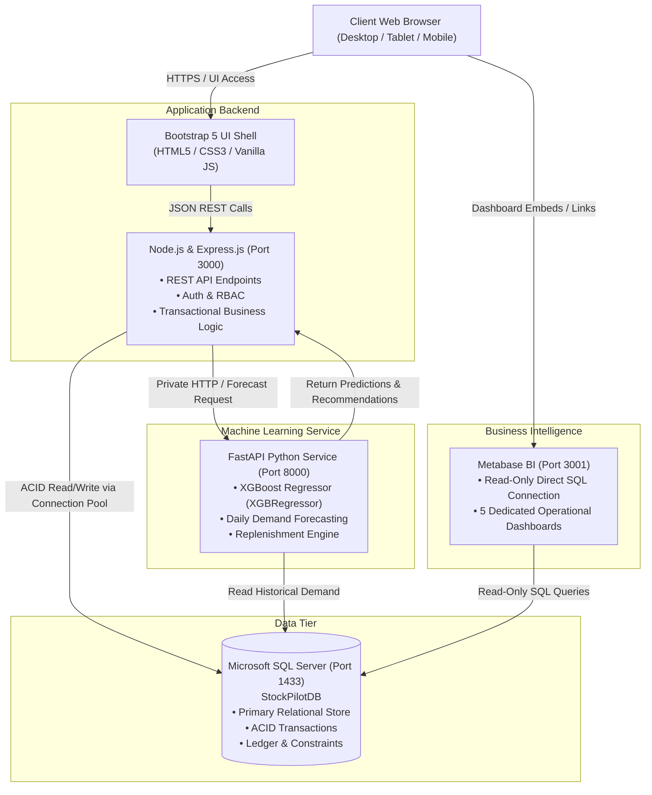

# StockPilot

**An Intelligent Inventory Management and Business Intelligence System for Small and Medium-Sized Businesses (SMBs)**

StockPilot is an enterprise-grade inventory operations and decision-support platform designed to streamline warehouse management, sales tracking, purchase order fulfillment, demand forecasting, and executive analytics for SMB retailers and distributors.

---

## Academic Alignment: TPDS-III

This project is developed under the **TPDS-III** curriculum, providing concrete implementations across all four syllabus modules:

| Syllabus Module | Implemented Component | Technologies |
|---|---|---|
| **Module 1: Dashboard Designing** | Executive, Sales, Inventory, Supplier & Forecast BI Dashboards | Metabase, Microsoft SQL Server, SQL |
| **Module 2: Front-End Development** | Responsive UI shell, forms, modal dialogs, data tables | HTML5, CSS3, Bootstrap 5, Vanilla JavaScript |
| **Module 3: Back-End Development** | RESTful web services, transactional ledger, authentication, RBAC | Node.js, Express.js, Microsoft SQL Server |
| **Module 4: Git and Deployment** | Strict branching model, container orchestration, VM hosting | Git, GitHub, Docker, Docker Compose, Linux Cloud VM |

*Note: The machine learning forecasting component (Python/FastAPI/XGBoost) serves as a specialized decision-support microservice and enhancement to the core Module 3 backend.*

---

## System Architecture Overview



---

## Technology Stack

- **Frontend:** HTML5, CSS3, Bootstrap 5, Vanilla JavaScript (no heavy frontend frameworks).
- **Backend Application:** Node.js LTS, Express.js, REST APIs.
- **Primary Database:** **Microsoft SQL Server only** (`StockPilotDB`).
- **Business Intelligence:** Metabase (connected to SQL Server via least-privilege read-only credentials).
- **Machine Learning:** Python, FastAPI, Pandas, NumPy, Scikit-learn, XGBoost Regressor (`XGBRegressor`).
- **Infrastructure:** Git/GitHub, Docker, Docker Compose, Linux VM.

---

## Current Project Status

- **Current Phase:** **Phase 3 — Complete (Bootstrap Frontend Shell, Catalog Screens & REST APIs)**
- **Next Phase:** Phase 4 — Inventory Ledger, Sales & Purchase Order Workflows *(Pending explicit user approval)*
- **Frontend & Catalog Status:** Responsive Bootstrap 5 user interface fully integrated with Express REST APIs and SQL Server. Features dynamic login/logout flows, role-tailored navigation bars (`Admin`, `Manager`, `Staff`), interactive product catalog management with search/category/stock filters and modal CRUD dialogs, commercial supplier directory, taxonomy categories manager, and 35/35 automated test cases passing (100%).

---

## Project Directory Structure

```text
StockPilot/
├── .gitignore
├── .env.example
├── LICENSE
├── README.md
├── StockPilot_Antigravity_Implementation_Plan.md
├── docs/
│   ├── architecture.md
│   ├── data-dictionary.md
│   ├── module-mapping.md
│   ├── requirements.md
│   ├── technical-decisions.md
│   └── phase-reports/
│       └── phase-00-report.md
```

---

## Documentation Quick Links

- [Project Requirements](file:///c:/Users/ayush/Desktop/StockPilot/docs/requirements.md)
- [System Architecture](file:///c:/Users/ayush/Desktop/StockPilot/docs/architecture.md)
- [TPDS-III Module Mapping](file:///c:/Users/ayush/Desktop/StockPilot/docs/module-mapping.md)
- [Data Dictionary & ERD Draft](file:///c:/Users/ayush/Desktop/StockPilot/docs/data-dictionary.md)
- [Database Setup & Operations Guide](file:///c:/Users/ayush/Desktop/StockPilot/sql/README.md)
- [Technical Decisions & Version Policy](file:///c:/Users/ayush/Desktop/StockPilot/docs/technical-decisions.md)
- [Phase 0 Completion Report](file:///c:/Users/ayush/Desktop/StockPilot/docs/phase-reports/phase-00-report.md)
- [Phase 1 Completion Report](file:///c:/Users/ayush/Desktop/StockPilot/docs/phase-reports/phase-01-report.md)
- [Phase 2 Completion Report](file:///c:/Users/ayush/Desktop/StockPilot/docs/phase-reports/phase-02-report.md)
- [Phase 3 Completion Report](file:///c:/Users/ayush/Desktop/StockPilot/docs/phase-reports/phase-03-report.md)

---

## License

This project is licensed under the terms of the MIT License. See [LICENSE](file:///c:/Users/ayush/Desktop/StockPilot/LICENSE) for details.
