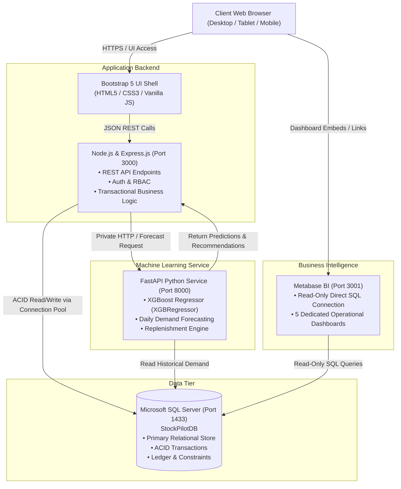

# StockPilot

**An Intelligent Inventory Management and Business Intelligence System for Small and Medium-Sized Businesses (SMBs)**

StockPilot is an enterprise-grade inventory operations and decision-support platform designed to streamline warehouse management, sales tracking, purchase order fulfillment, demand forecasting, and executive analytics for SMB retailers and distributors.

---

## Academic Alignment: TPDS-III

This project is developed under the **TPDS-III** curriculum, providing concrete implementations across all four syllabus modules:

| Syllabus Module | Implemented Component | Technologies |
|---|---|---|
| **Module 1: Dashboard Designing** | Executive, Sales, Inventory, Supplier & Forecast BI Dashboards | Metabase, Microsoft SQL Server, SQL |
| **Module 2: Front-End Development** | Responsive UI shell, forms, modal dialogs, data tables | HTML5, CSS3, Bootstrap 5, Vanilla JavaScript |
| **Module 3: Back-End Development** | RESTful web services, transactional ledger, authentication, RBAC | Node.js, Express.js, Microsoft SQL Server |
| **Module 4: Git and Deployment** | Strict branching model, container orchestration, VM hosting | Git, GitHub, Docker, Docker Compose, Linux Cloud VM |

*Note: The machine learning forecasting component (Python/FastAPI/XGBoost) serves as a specialized decision-support microservice and enhancement to the core Module 3 backend.*

---

## System Architecture Overview



---

## Technology Stack

- **Frontend:** HTML5, CSS3, Bootstrap 5, Vanilla JavaScript (no heavy frontend frameworks).
- **Backend Application:** Node.js LTS, Express.js, REST APIs.
- **Primary Database:** **Microsoft SQL Server only** (`StockPilotDB`).
- **Business Intelligence:** Metabase (connected to SQL Server via least-privilege read-only credentials).
- **Machine Learning:** Python, FastAPI, Pandas, NumPy, Scikit-learn, XGBoost Regressor (`XGBRegressor`).
- **Infrastructure:** Git/GitHub, Docker, Docker Compose, Linux VM.

---

## Current Project Status

- **Current Phase:** **Phase 9 — Complete (End-to-End QA, Security Review & Final Submission Package)**
- **System Readiness:** **TPDS-III Final Submission Ready (100% Implemented & Verified)**
- **Curriculum Compliance:** All four syllabus modules (Module 1: Dashboard Designing, Module 2: Front-End Development, Module 3: Back-End Development, Module 4: Git and Deployment) are fully realized and verified.
- **Verification Summary:** **103/103 automated tests passing (100% pass rate)** across 10 Jest test suites (81 tests) and 6 Pytest ML modules (22 tests).
- **Academic Package:** Complete submission deliverables ready in `submission/` including 9-slide presentation deck, curriculum mapping matrix, formal final report, evaluator demo script, screenshot references, and test evidence.

---

## Project Directory Structure

```text
StockPilot/
├── .gitignore
├── .dockerignore
├── .env.example
├── docker-compose.yml
├── Dockerfile
├── LICENSE
├── README.md
├── StockPilot_Antigravity_Implementation_Plan.md
├── docs/
│   ├── architecture.md
│   ├── bi-data-dictionary-and-kpis.md
│   ├── data-dictionary.md
│   ├── docker-deployment-guide.md
│   ├── ml-model-card.md
│   ├── module-mapping.md
│   ├── requirements.md
│   ├── technical-decisions.md
│   └── phase-reports/
│       ├── phase-00-report.md
│       ├── phase-01-report.md
│       ├── phase-02-report.md
│       ├── phase-03-report.md
│       ├── phase-04-report.md
│       ├── phase-05-report.md
│       ├── phase-06-report.md
│       ├── phase-07-report.md
│       ├── phase-08-report.md
│       └── phase-09-report.md
├── ml/
│   ├── Dockerfile
│   ├── data/
│   ├── features/
│   ├── models/
│   ├── service/
│   ├── artifacts/v1/
│   ├── tests/
│   └── requirements.txt
├── public/
│   ├── index.html
│   ├── login.html
│   ├── products.html
│   ├── categories.html
│   ├── suppliers.html
│   ├── inventory.html
│   ├── sales.html
│   ├── purchase-orders.html
│   ├── recommendations.html
│   ├── analytics.html
│   ├── css/style.css
│   └── js/
├── src/
│   ├── app.js
│   ├── server.js
│   ├── config/
│   ├── controllers/
│   ├── middleware/
│   ├── repositories/
│   ├── routes/
│   ├── services/
│   └── docs/openapi.yaml
├── submission/
│   ├── StockPilot_Project_Presentation.md
│   ├── Four_Module_Mapping.md
│   ├── StockPilot_Final_Report.md
│   ├── Demo_Script.md
│   ├── Screenshots/
│   │   └── README.md
│   └── Test_Evidence/
│       ├── api-test-results.md
│       ├── database-test-results.md
│       ├── ml-evaluation.md
│       └── security-audit.md
└── tests/
    ├── integration/
    └── unit/
```

---

## Documentation & Academic Submission Quick Links

### TPDS-III Academic Submission Package
- [Academic 9-Slide Presentation Deck](file:///c:/Users/ayush/Desktop/StockPilot/submission/StockPilot_Project_Presentation.md)
- [Four-Module Syllabus Compliance Matrix](file:///c:/Users/ayush/Desktop/StockPilot/submission/Four_Module_Mapping.md)
- [Comprehensive Academic Final Report](file:///c:/Users/ayush/Desktop/StockPilot/submission/StockPilot_Final_Report.md)
- [Evaluator Live Demonstration Script](file:///c:/Users/ayush/Desktop/StockPilot/submission/Demo_Script.md)
- [Screenshots & Visual Catalog Guide](file:///c:/Users/ayush/Desktop/StockPilot/submission/Screenshots/README.md)
- [API Test Results Evidence](file:///c:/Users/ayush/Desktop/StockPilot/submission/Test_Evidence/api-test-results.md)
- [Database Schema & Invariants Evidence](file:///c:/Users/ayush/Desktop/StockPilot/submission/Test_Evidence/database-test-results.md)
- [ML Forecasting Model Card & Benchmarks](file:///c:/Users/ayush/Desktop/StockPilot/submission/Test_Evidence/ml-evaluation.md)
- [Security Governance & Audit Review](file:///c:/Users/ayush/Desktop/StockPilot/submission/Test_Evidence/security-audit.md)

### Technical Specifications & Operations Guides
- [System Architecture Specification](file:///c:/Users/ayush/Desktop/StockPilot/docs/architecture.md)
- [Project Requirements & Invariants](file:///c:/Users/ayush/Desktop/StockPilot/docs/requirements.md)
- [Docker Deployment Guide & Operations Runbook](file:///c:/Users/ayush/Desktop/StockPilot/docs/docker-deployment-guide.md)
- [BI KPI Definitions & Reconciliation Guide](file:///c:/Users/ayush/Desktop/StockPilot/docs/bi-data-dictionary-and-kpis.md)
- [Data Dictionary & Entity Relationships](file:///c:/Users/ayush/Desktop/StockPilot/docs/data-dictionary.md)
- [Technical Decisions & Version Policies](file:///c:/Users/ayush/Desktop/StockPilot/docs/technical-decisions.md)

### Phase Implementation Reports
- [Phase 0 Report — Repository Baseline & Architecture Freeze](file:///c:/Users/ayush/Desktop/StockPilot/docs/phase-reports/phase-00-report.md)
- [Phase 1 Report — SQL Server Schema & Seed Data](file:///c:/Users/ayush/Desktop/StockPilot/docs/phase-reports/phase-01-report.md)
- [Phase 2 Report — Express Backend & Authentication](file:///c:/Users/ayush/Desktop/StockPilot/docs/phase-reports/phase-02-report.md)
- [Phase 3 Report — Frontend Shell & Catalog CRUD](file:///c:/Users/ayush/Desktop/StockPilot/docs/phase-reports/phase-03-report.md)
- [Phase 4 Report — Inventory Ledger, Sales POS & Purchase Orders](file:///c:/Users/ayush/Desktop/StockPilot/docs/phase-reports/phase-04-report.md)
- [Phase 5 Report — Metabase & SQL Server BI Dashboards](file:///c:/Users/ayush/Desktop/StockPilot/docs/phase-reports/phase-05-report.md)
- [Phase 6 Report — ML Dataset & XGBoost Model Training](file:///c:/Users/ayush/Desktop/StockPilot/docs/phase-reports/phase-06-report.md)
- [Phase 7 Report — FastAPI Service & Replenishment Logic](file:///c:/Users/ayush/Desktop/StockPilot/docs/phase-reports/phase-07-report.md)
- [Phase 8 Report — Dockerization & Local Environment](file:///c:/Users/ayush/Desktop/StockPilot/docs/phase-reports/phase-08-report.md)
- [Phase 9 Report — End-to-End QA, Security Review & Submission Package](file:///c:/Users/ayush/Desktop/StockPilot/docs/phase-reports/phase-09-report.md)

---

## License

This project is licensed under the terms of the MIT License. See [LICENSE](file:///c:/Users/ayush/Desktop/StockPilot/LICENSE) for details.
