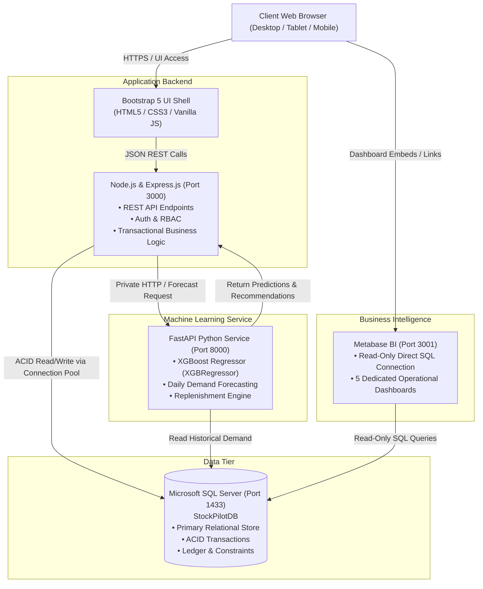

# StockPilot

**An Intelligent Inventory Management and Business Intelligence System for Small and Medium-Sized Businesses (SMBs)**

StockPilot is an enterprise-grade inventory operations and decision-support platform designed to streamline warehouse management, sales tracking, purchase order fulfillment, demand forecasting, and executive analytics for SMB retailers and distributors.

---

## Academic Alignment: TPDS-III

This project is developed under the **TPDS-III** curriculum, providing concrete implementations across all four syllabus modules:

| Syllabus Module | Implemented Component | Technologies |
|---|---|---|
| **Module 1: Dashboard Designing** | Executive, Sales, Inventory, Supplier & Forecast BI Dashboards | Metabase, Microsoft SQL Server, SQL |
| **Module 2: Front-End Development** | Responsive UI shell, forms, modal dialogs, data tables | HTML5, CSS3, Bootstrap 5, Vanilla JavaScript |
| **Module 3: Back-End Development** | RESTful web services, transactional ledger, authentication, RBAC | Node.js, Express.js, Microsoft SQL Server |
| **Module 4: Git and Deployment** | Strict branching model, container orchestration, VM hosting | Git, GitHub, Docker, Docker Compose, Linux Cloud VM |

*Note: The machine learning forecasting component (Python/FastAPI/XGBoost) serves as a specialized decision-support microservice and enhancement to the core Module 3 backend.*

---

## System Architecture Overview



---

## Technology Stack

- **Frontend:** HTML5, CSS3, Bootstrap 5, Vanilla JavaScript (no heavy frontend frameworks).
- **Backend Application:** Node.js LTS, Express.js, REST APIs.
- **Primary Database:** **Microsoft SQL Server only** (`StockPilotDB`).
- **Business Intelligence:** Metabase (connected to SQL Server via least-privilege read-only credentials).
- **Machine Learning:** Python, FastAPI, Pandas, NumPy, Scikit-learn, XGBoost Regressor (`XGBRegressor`).
- **Infrastructure:** Git/GitHub, Docker, Docker Compose, Linux VM.

---

## Current Project Status

- **Current Phase:** **Phase 5 — Complete (Metabase & SQL Server Business Intelligence Dashboards)**
- **Next Phase:** Phase 6 — ML Dataset Engineering, Baseline Models & XGBoost Training *(Pending explicit user approval)*
- **Business Intelligence Status:** TPDS-III Module 1 fulfilled. Metabase v0.50.32 deployed on port 3001 via Docker with dedicated least-privilege read-only SQL Server account (`stockpilot_bi_readonly`). Implemented 5 specialized BI reporting views in SQL Server (`vw_BI_ExecutiveKPIs`, `vw_BI_DailySalesTrends`, `vw_BI_CategoryPerformance`, `vw_BI_TopProducts`, `vw_BI_SupplierPerformance`), comprehensive in-app analytics dashboard (`public/analytics.html`), KPI data dictionary with mathematical definitions and reconciliation audits, and 61/61 automated test cases passing (100%).

---

## Project Directory Structure

```text
StockPilot/
├── .gitignore
├── .env.example
├── docker-compose.yml
├── LICENSE
├── README.md
├── StockPilot_Antigravity_Implementation_Plan.md
├── docs/
│   ├── architecture.md
│   ├── bi-data-dictionary-and-kpis.md
│   ├── data-dictionary.md
│   ├── module-mapping.md
│   ├── requirements.md
│   ├── technical-decisions.md
│   └── phase-reports/
│       ├── phase-00-report.md
│       ├── phase-01-report.md
│       ├── phase-02-report.md
│       ├── phase-03-report.md
│       ├── phase-04-report.md
│       ├── phase-05-report.md
│       └── phase-06-report.md
├── ml/
│   ├── data/
│   ├── features/
│   ├── models/
│   ├── artifacts/v1/
│   ├── tests/
│   └── requirements.txt
├── public/
│   ├── index.html
│   ├── login.html
│   ├── products.html
│   ├── categories.html
│   ├── suppliers.html
│   ├── inventory.html
│   ├── sales.html
│   ├── purchase-orders.html
│   ├── analytics.html
│   ├── css/style.css
│   └── js/
├── src/
│   ├── app.js
│   ├── server.js
│   ├── config/
│   ├── controllers/
│   ├── middleware/
│   ├── repositories/
│   ├── routes/
│   ├── services/
│   └── docs/openapi.yaml
└── tests/
```

---

## Documentation Quick Links

- [Project Requirements](file:///c:/Users/ayush/Desktop/StockPilot/docs/requirements.md)
- [System Architecture](file:///c:/Users/ayush/Desktop/StockPilot/docs/architecture.md)
- [TPDS-III Module Mapping](file:///c:/Users/ayush/Desktop/StockPilot/docs/module-mapping.md)
- [Data Dictionary & ERD Draft](file:///c:/Users/ayush/Desktop/StockPilot/docs/data-dictionary.md)
- [BI KPI Definitions & Reconciliation Guide](file:///c:/Users/ayush/Desktop/StockPilot/docs/bi-data-dictionary-and-kpis.md)
- [ML Demand Forecasting Model Card](file:///c:/Users/ayush/Desktop/StockPilot/docs/ml-model-card.md)
- [Database Setup & Operations Guide](file:///c:/Users/ayush/Desktop/StockPilot/sql/README.md)
- [Technical Decisions & Version Policy](file:///c:/Users/ayush/Desktop/StockPilot/docs/technical-decisions.md)
- [Phase 0 Completion Report](file:///c:/Users/ayush/Desktop/StockPilot/docs/phase-reports/phase-00-report.md)
- [Phase 1 Completion Report](file:///c:/Users/ayush/Desktop/StockPilot/docs/phase-reports/phase-01-report.md)
- [Phase 2 Completion Report](file:///c:/Users/ayush/Desktop/StockPilot/docs/phase-reports/phase-02-report.md)
- [Phase 3 Completion Report](file:///c:/Users/ayush/Desktop/StockPilot/docs/phase-reports/phase-03-report.md)
- [Phase 4 Completion Report](file:///c:/Users/ayush/Desktop/StockPilot/docs/phase-reports/phase-04-report.md)
- [Phase 5 Completion Report](file:///c:/Users/ayush/Desktop/StockPilot/docs/phase-reports/phase-05-report.md)
- [Phase 6 Completion Report](file:///c:/Users/ayush/Desktop/StockPilot/docs/phase-reports/phase-06-report.md)
- [Phase 7 Completion Report](file:///c:/Users/ayush/Desktop/StockPilot/docs/phase-reports/phase-07-report.md)

---

## License

This project is licensed under the terms of the MIT License. See [LICENSE](file:///c:/Users/ayush/Desktop/StockPilot/LICENSE) for details.
