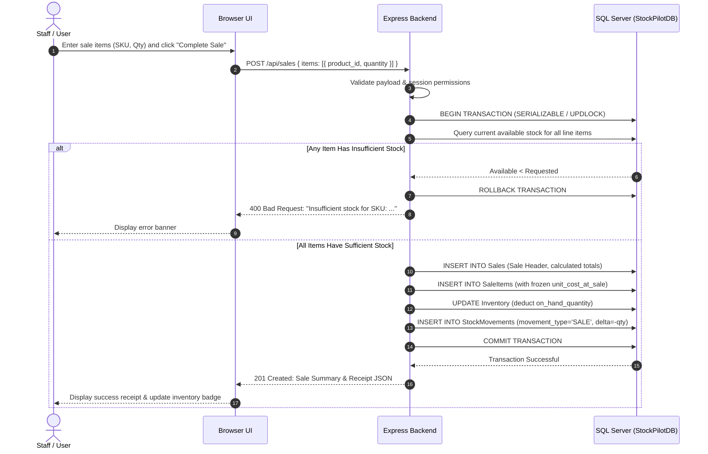
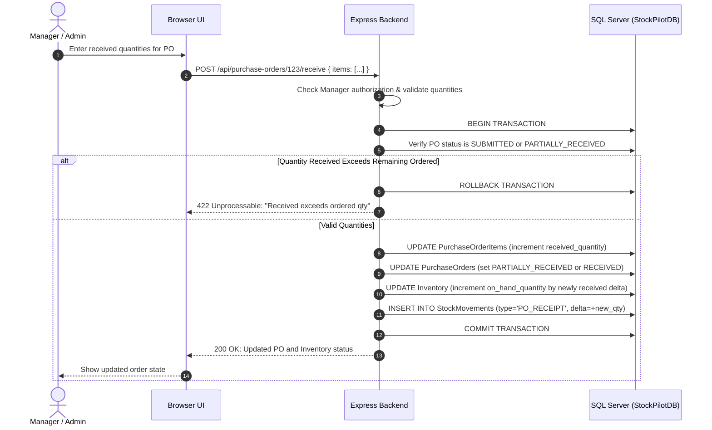
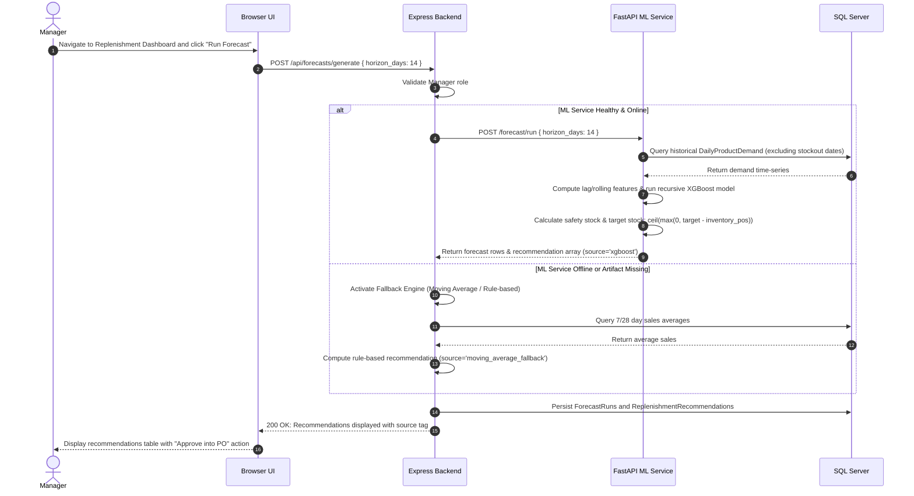

# StockPilot — System Architecture & Component Specification

**Document Version:** 1.0  
**Phase:** Phase 0 (Baseline Freeze)  
**Author:** Lead Software Engineer  
**Status:** Approved for Phase 0 Baseline  

---

## 1. High-Level System Architecture

StockPilot adopts a clean, modular multi-tier architecture where the primary business logic, operational transactions, and access control reside within a **Node.js/Express.js** application backend, backed by **Microsoft SQL Server**. Analytical reporting is decoupled into **Metabase**, while time-series machine learning forecasting is isolated in a **Python/FastAPI** microservice.

```mermaid
graph TD
    subgraph ClientTier["Client Tier (User Devices)"]
        Browser["Modern Web Browser<br>(Desktop / Tablet / Mobile)"]
    end

    subgraph EdgePerimeter["Edge / Network Perimeter"]
        PortMap["Public Port Mapping<br>• 3000: Express Web App<br>• 3001: Metabase (Restricted / Proxy)"]
    end

    subgraph InternalDockerNet["Isolated Docker Network (stockpilot_net)"]
        subgraph AppContainer["App Service Container"]
            Express["Node.js + Express.js<br>• Controllers & Routes<br>• Service Domain Layer<br>• Repository / Query Layer<br>• Session & RBAC Middleware"]
            StaticFiles["Bootstrap 5 UI Shell<br>(HTML5 / CSS3 / Vanilla JS)"]
        end

        subgraph MLContainer["ML Service Container"]
            FastAPI["Python 3.x + FastAPI<br>• XGBoost Regressor (`XGBRegressor`)<br>• Recursive 14-day Forecasting<br>• Safety Stock & Replenishment Logic"]
            ModelArtifacts["Model Artifacts<br>(xgboost_model.json, preprocessors)"]
        end

        subgraph DBContainer["Database Service Container"]
            MSSQL[("Microsoft SQL Server 2022<br>Database: StockPilotDB<br>• ACID Transactions<br>• Stock Movement Ledger<br>• Clustered & Nonclustered Indexes")]
        end

        subgraph BIContainer["BI Analytics Container"]
            Metabase["Metabase Engine<br>• Visual Question Builder<br>• SQL Query Dashboards<br>• Internal Metadata DB (H2 / Postgres)"]
        end
    end

    Browser -->|HTTP:3000| PortMap
    PortMap --> StaticFiles
    Browser -->|REST API Calls| Express
    Express -->|Tedious / mssql Pool (Port 1433)| MSSQL
    Express -->|Internal HTTP (Port 8000)| FastAPI
    FastAPI -->|Read Historical Demand (pyodbc/mssql)| MSSQL
    FastAPI --> ModelArtifacts
    Metabase -->|Read-Only SQL Account (Port 1433)| MSSQL
    Browser -.->|Dashboard Embeds / Direct View| Metabase
```

---

## 2. Component Responsibilities

### 2.1 Front-End Layer (Bootstrap 5 & Vanilla JS)
- **Presentation:** Lightweight, dependency-free responsive user interface utilizing Bootstrap 5 grid, navbars, cards, modals, tables, and badge indicators.
- **Client Logic:** Standard ES6+ JavaScript utilizing the `Fetch API` for asynchronous communication with the Express backend.
- **State Management:** Minimal DOM-driven state; renders server-provided JSON responses without client-side MVC framework bloat.
- **Input Validation:** Instant feedback on form bounds (positive numbers, required fields), complemented by authoritative server-side validation.

### 2.2 Primary Backend Application (Node.js & Express.js)
- **Role:** The core operational engine and single point of authority for business rules, sales, inventory adjustments, and purchasing.
- **Layered Architecture:**
  - `Routes`: Declares URL endpoints and binds authentication/authorization middleware.
  - `Controllers`: Parses HTTP requests, coordinates service calls, and formats HTTP responses.
  - `Services`: Executes business logic (e.g. validating sale quantities, calculating totals, triggering replenishments).
  - `Repositories`: Encapsulates SQL Server queries, stored procedure calls, and multi-statement transactions using connection pooling.
- **Authentication & RBAC:** Enforces session validation and role authorization (Admin, Manager, Staff) on every protected endpoint.
- **Resilience Coordinator:** Orchestrates requests to the ML service; seamlessly invokes rule-based moving-average fallbacks if the ML service is down or model artifacts are unready.

### 2.3 Business Database (Microsoft SQL Server)
- **Role:** Sole source of truth for all transactional, inventory, catalog, and demand data (`StockPilotDB`).
- **Data Integrity:** Primary keys, foreign keys, unique constraints (`SKU`, `Email`), non-negative check constraints (`stock >= 0`, `price >= 0`).
- **ACID Transactions:** Enforces atomic commits for sales (header, items, inventory deduction, stock movement) and PO receipts.
- **Concurrency Protection:** Employs explicit pessimistic locking (`UPDLOCK`, `HOLDLOCK`) or rowversion concurrency tokens during inventory operations to eliminate race conditions and overselling.
- **Ledger Invariant:** Every inventory change is paired with an immutable `StockMovements` record.

### 2.4 Business Intelligence Engine (Metabase)
- **Role:** Interactive analytical dashboard suite providing visualizations for executive leadership and operations managers.
- **Database Access:** Connects directly to `StockPilotDB` using a dedicated, least-privilege SQL Server user (`stockpilot_bi_readonly`) with `SELECT` permissions strictly limited to analytical views and reporting tables.
- **Decoupled Architecture:** Metabase internal application metadata (saved cards, dashboard layouts, user accounts) is kept completely separate from the `StockPilotDB` business schema.

### 2.5 Machine Learning Forecasting Microservice (FastAPI & XGBoost)
- **Role:** Specialized, asynchronously called decision-support microservice.
- **Framework:** Python 3.x with FastAPI for lightweight, high-performance internal REST endpoints.
- **Forecasting Pipeline:**
  - Ingests chronological daily demand records (`DailyProductDemand`).
  - Preprocesses temporal, calendar, promotional, lag, and rolling-window features.
  - Executes recursive 14-day inference using a trained `XGBRegressor`.
  - Computes empirical safety stock from chronological backtest error percentiles.
  - Outputs replenishment recommendations with clear source provenance (`xgboost` vs. `moving_average_fallback`).
- **Human-in-the-Loop:** Forecast recommendations do not automatically purchase stock; they require explicit review and authorization by an authenticated Manager in the Express application.

---

## 3. Data Flow & Transaction Lifecycles

### 3.1 Point-of-Sale (POS) Transaction Flow



### 3.2 Purchase Order Receiving Flow



### 3.3 Demand Forecasting & Replenishment Flow



---

## 4. Security & Network Architecture

### 4.1 Network Segmentation
- All inter-service communications (Node.js <-> SQL Server, Node.js <-> FastAPI, Metabase <-> SQL Server) occur inside an isolated Docker internal network (`stockpilot_net`).
- Only port `3000` (Node.js Application) and port `3001` (Metabase BI) are exposed to host interfaces.
- The SQL Server listener (`1433`) and FastAPI ML listener (`8000`) are strictly internal to the container network and not bound to public interfaces in production.

### 4.2 Database Security & Principle of Least Privilege
SQL Server uses separate role-tailored database principals:
1. `stockpilot_admin` / `sa`: Used exclusively for migrations, DDL execution, and administrative setup.
2. `stockpilot_app`: Used by the Node.js backend. Granted `SELECT`, `INSERT`, `UPDATE` permissions on operational tables. No DDL/DROP table privileges.
3. `stockpilot_bi_readonly`: Used by Metabase. Granted `SELECT` permission exclusively on reporting views (`vw_*`) and operational tables. Prohibited from modifying data.
4. `stockpilot_ml`: Used by the ML service. Granted `SELECT` on demand views, and restricted `INSERT` into `DemandForecasts` and `ForecastRuns`.
