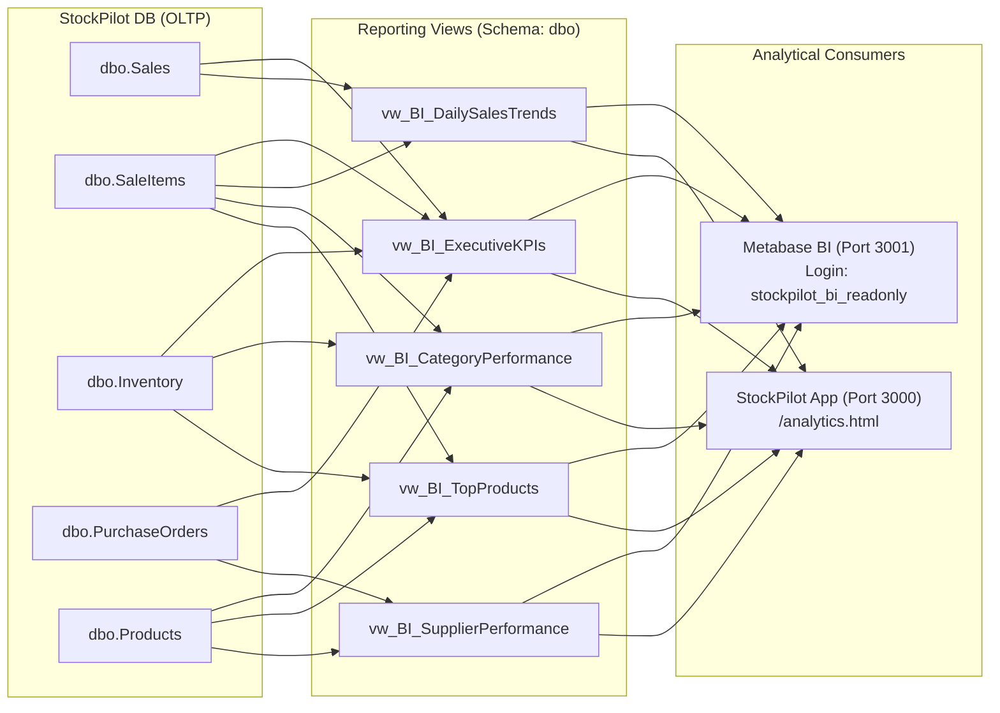

# StockPilot — Business Intelligence KPI Definitions & Reconciliation Guide

**Document Version:** 1.0  
**Phase:** Phase 5 (Business Intelligence & Dashboards)  
**Academic Alignment:** TPDS-III Module 1 (Dashboard Designing)  
**Author:** Lead Software Engineer  
**Database Engine:** Microsoft SQL Server (`StockPilotDB`)  
**BI Engine:** Metabase Open-Source BI & Embedded Analytics  

---

## 1. Overview & Architecture

StockPilot decouples operational online transaction processing (OLTP) from analytical reporting (OLAP) via dedicated relational reporting views and a least-privileged read-only database login:



---

## 2. Metabase Connection Configuration

| Parameter | Recommended Value | Notes |
|---|---|---|
| **Database Type** | Microsoft SQL Server | Native JDBC connector included in Metabase |
| **Host** | `stockpilot-mssql` (Docker net) or `localhost` | Container or host network |
| **Port** | `1433` | Standard SQL Server TCP listener |
| **Database Name** | `StockPilotDB` | Primary business database |
| **Username** | `stockpilot_bi_readonly` | Dedicated least-privilege BI user |
| **Password** | `YourStrong@Passw0rdBI!` | Enforced read-only credentials |
| **SSL / Trust Server Cert** | Enabled (`trustServerCertificate=true`) | Self-signed container certificate |
| **Privilege Level** | `db_datareader` with `DENY INSERT, UPDATE, DELETE` | Cannot modify operational rows |

---

## 3. The 5 Core Dashboards & KPI Specifications

### Dashboard 1: Executive Overview Dashboard
**Target Audience:** Business Owner, Chief Operating Officer, Store General Manager.  
**Purpose:** Provides a 360-degree operational and financial snapshot of the business.

| KPI Metric Name | Formula / SQL Definition | Source Tables | Reconciliation Target |
|---|---|---|---|
| **Total Gross Revenue** | `SUM(total_amount)` WHERE `status = 'COMPLETED'` | `dbo.Sales` | Must equal sum of sales receipt totals |
| **Total Net Sales (Subtotal)** | `SUM(subtotal_amount)` WHERE `status = 'COMPLETED'` | `dbo.Sales` | Excludes sales tax collected |
| **Total Gross Profit** | `SUM((si.unit_selling_price - si.unit_cost_at_sale) * si.quantity)` | `dbo.SaleItems` | Frozen historical cost margin |
| **Overall Gross Margin %** | `(Total Gross Profit / Total Subtotal Revenue) * 100` | `dbo.Sales`, `dbo.SaleItems` | Percentage profitability |
| **Total Inventory Valuation** | `SUM(i.on_hand_quantity * p.cost_price)` | `dbo.Products`, `dbo.Inventory` | Current book value of stock |
| **Critical Stockout Count** | `COUNT(*)` WHERE `on_hand_quantity <= 0` | `dbo.Inventory` | SKUs currently at zero balance |
| **Low Stock Alert Count** | `COUNT(*)` WHERE `on_hand_quantity <= reorder_point_threshold AND on_hand_quantity > 0` | `dbo.Inventory`, `dbo.Products` | SKUs needing reordering |

---

### Dashboard 2: Sales Analytics Dashboard
**Target Audience:** Sales Manager, Store Supervisors.  
**Purpose:** Analyzes revenue momentum, daily demand trends, basket size, and customer purchasing patterns.

| KPI Metric Name | Formula / SQL Definition | Visualization Type |
|---|---|---|
| **Daily Sales Revenue Trend** | `CAST(sale_date AS DATE)`, `SUM(total_amount)` | Line Chart / Time-series Bar |
| **Daily Units Sold** | `SUM(si.quantity)` grouped by Date | Bar Chart |
| **Average Order Value (AOV)** | `SUM(total_amount) / COUNT(DISTINCT sale_id)` | Single Value Card |
| **Sales Velocity by Category** | `SUM(si.quantity)` grouped by Category | Donut / Pie Chart |
| **Gross Margin Trend** | `(Daily Gross Profit / Daily Subtotal) * 100` | Line Chart |

---

### Dashboard 3: Inventory Analytics Dashboard
**Target Audience:** Warehouse Manager, Inventory Controller.  
**Purpose:** Tracks asset distribution, stock turn, holding valuation, and warehouse balance health.

| KPI Metric Name | Formula / SQL Definition | Visualization Type |
|---|---|---|
| **Valuation by Category** | `SUM(i.on_hand_quantity * p.cost_price)` by Category | Stacked Horizontal Bar |
| **Stock Health Distribution** | Count of SKUs in `HEALTHY`, `LOW_STOCK`, `OUT_OF_STOCK` | Donut Chart |
| **Movement Ledger Breakdown** | `COUNT(*)` grouped by `movement_type` (`SALE`, `PO_RECEIPT`, `ADJUSTMENT`) | Bar Chart |
| **Slow Movers (Dormant SKUs)** | Products with zero sales in last 30 days and `on_hand_quantity > 0` | Data Table with SKU & Days Idle |

---

### Dashboard 4: Supplier Performance & Purchasing Dashboard
**Target Audience:** Procurement Officer, Purchasing Manager.  
**Purpose:** Evaluates supplier dependability, purchase order status, and capital expenditure across vendors.

| KPI Metric Name | Formula / SQL Definition | Visualization Type |
|---|---|---|
| **Purchasing Spend by Supplier** | `SUM(total_amount)` WHERE `status <> 'CANCELLED'` | Horizontal Bar Chart |
| **PO Status Distribution** | Count of POs by `DRAFT`, `SUBMITTED`, `PARTIALLY_RECEIVED`, `RECEIVED` | Donut Chart |
| **Supplier Fulfillment Rate %** | `(SUM(received_quantity) / SUM(ordered_quantity)) * 100` | Gauge / Progress Meter |
| **Active Open PO Spend** | `SUM(total_amount)` WHERE `status IN ('SUBMITTED', 'PARTIALLY_RECEIVED')` | Metric Card |

---

### Dashboard 5: Forecast Analytics & Replenishment Dashboard
**Target Audience:** Inventory Planner, Purchasing Decision Maker.  
**Purpose:** Compares target safety stock vs actual stock position and surfaces immediate replenishment candidates.

| KPI Metric Name | Formula / SQL Definition | Visualization Type |
|---|---|---|
| **Net Inventory Position** | `on_hand - reserved + open_purchase_quantity` | Metric / Data Table |
| **Suggested Reorder Quantity** | `target_safety_stock + (reorder_point - inventory_position)` | Number Column |
| **Urgency Classification** | `CRITICAL_STOCKOUT` vs `REORDER_NEEDED` | Color-Coded Priority Badges |

---

## 4. SQL Reconciliation & Audit Verification Queries

To independently verify that BI numbers match source data without distortion, execute the following audit queries:

```sql
-- Reconciliation 1: Total Sales Revenue Match
SELECT 
    (SELECT total_gross_revenue FROM dbo.vw_BI_ExecutiveKPIs) AS bi_view_revenue,
    (SELECT SUM(total_amount) FROM dbo.Sales WHERE status = 'COMPLETED') AS source_table_revenue,
    CASE 
        WHEN (SELECT total_gross_revenue FROM dbo.vw_BI_ExecutiveKPIs) = (SELECT SUM(total_amount) FROM dbo.Sales WHERE status = 'COMPLETED')
        THEN 'RECONCILED' ELSE 'MISMATCH' 
    END AS audit_status;

-- Reconciliation 2: Inventory Valuation Match
SELECT 
    (SELECT total_inventory_valuation FROM dbo.vw_BI_ExecutiveKPIs) AS bi_view_valuation,
    (SELECT SUM(i.on_hand_quantity * p.cost_price) FROM dbo.Products p INNER JOIN dbo.Inventory i ON p.product_id = i.product_id WHERE p.is_active = 1) AS source_valuation,
    CASE 
        WHEN (SELECT total_inventory_valuation FROM dbo.vw_BI_ExecutiveKPIs) = (SELECT SUM(i.on_hand_quantity * p.cost_price) FROM dbo.Products p INNER JOIN dbo.Inventory i ON p.product_id = i.product_id WHERE p.is_active = 1)
        THEN 'RECONCILED' ELSE 'MISMATCH' 
    END AS audit_status;
```
