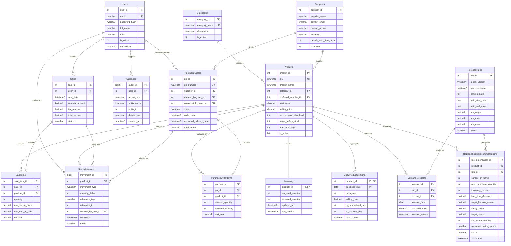

# StockPilot — Initial Data Dictionary & Entity-Relationship Specification

**Document Version:** 1.0  
**Phase:** Phase 0 (Baseline Freeze)  
**Author:** Lead Software Engineer  
**Database Engine:** Microsoft SQL Server (`StockPilotDB`)  
**Status:** Approved for Phase 0 Baseline  

---

## 1. Entity-Relationship Diagram (ERD)

---

## 2. Table Schemas & Data Types

### 2.1 `Users`
Stores authorized system operators and their credentials.
| Column | Type | Nullable | Constraints / Defaults | Description |
|---|---|:---:|---|---|
| `user_id` | `INT IDENTITY(1,1)` | No | `PK` | Unique internal user ID |
| `email` | `NVARCHAR(255)` | No | `UNIQUE` | User login email address |
| `password_hash` | `NVARCHAR(255)` | No | | Bcrypt password hash |
| `full_name` | `NVARCHAR(100)` | No | | User's display name |
| `role` | `NVARCHAR(20)` | No | `CHECK (role IN ('Admin', 'Manager', 'Staff'))` | Access control role |
| `is_active` | `BIT` | No | `DEFAULT 1` | Soft-deactivation flag |
| `created_at` | `DATETIME2` | No | `DEFAULT SYSUTCDATETIME()` | UTC registration timestamp |
| `updated_at` | `DATETIME2` | No | `DEFAULT SYSUTCDATETIME()` | UTC modification timestamp |

### 2.2 `Categories`
Taxonomic categorization of products.
| Column | Type | Nullable | Constraints / Defaults | Description |
|---|---|:---:|---|---|
| `category_id` | `INT IDENTITY(1,1)` | No | `PK` | Unique category identifier |
| `category_name` | `NVARCHAR(100)` | No | `UNIQUE` | Display name of the category |
| `description` | `NVARCHAR(500)` | Yes | | Optional category description |
| `is_active` | `BIT` | No | `DEFAULT 1` | Soft-deactivation flag |

### 2.3 `Suppliers`
Supplier contact profiles and fulfillment defaults.
| Column | Type | Nullable | Constraints / Defaults | Description |
|---|---|:---:|---|---|
| `supplier_id` | `INT IDENTITY(1,1)` | No | `PK` | Unique supplier identifier |
| `supplier_name` | `NVARCHAR(150)` | No | | Legal or business name |
| `contact_email` | `NVARCHAR(255)` | Yes | | Primary order contact email |
| `contact_phone` | `NVARCHAR(50)` | Yes | | Telephone number |
| `address` | `NVARCHAR(300)` | Yes | | Physical / billing address |
| `default_lead_time_days`| `INT` | No | `DEFAULT 7, CHECK (default_lead_time_days >= 0)` | Expected lead time in days |
| `is_active` | `BIT` | No | `DEFAULT 1` | Active vendor status |
| `created_at` | `DATETIME2` | No | `DEFAULT SYSUTCDATETIME()` | Creation timestamp |

### 2.4 `Products`
The catalog master table.
| Column | Type | Nullable | Constraints / Defaults | Description |
|---|---|:---:|---|---|
| `product_id` | `INT IDENTITY(1,1)` | No | `PK` | Internal product identifier |
| `sku` | `NVARCHAR(50)` | No | `UNIQUE` | Stock Keeping Unit code |
| `product_name` | `NVARCHAR(200)` | No | | Commercial product title |
| `category_id` | `INT` | No | `FK -> Categories(category_id)` | Product classification |
| `preferred_supplier_id`| `INT` | Yes | `FK -> Suppliers(supplier_id)` | Primary replenishment vendor |
| `cost_price` | `DECIMAL(18,4)` | No | `CHECK (cost_price >= 0)` | Current acquisition cost |
| `selling_price`| `DECIMAL(18,4)` | No | `CHECK (selling_price >= 0)` | Standard customer retail price |
| `reorder_point_threshold`| `INT` | No | `DEFAULT 10, CHECK (reorder_point_threshold >= 0)` | Static minimum stock trigger |
| `target_safety_stock` | `INT` | No | `DEFAULT 15, CHECK (target_safety_stock >= 0)` | Static target buffer |
| `lead_time_days` | `INT` | No | `DEFAULT 7, CHECK (lead_time_days >= 0)` | Product-specific supplier lead time |
| `is_active` | `BIT` | No | `DEFAULT 1` | Soft-delete status |
| `created_at` | `DATETIME2` | No | `DEFAULT SYSUTCDATETIME()` | Creation timestamp |
| `updated_at` | `DATETIME2` | No | `DEFAULT SYSUTCDATETIME()` | Modification timestamp |

### 2.5 `Inventory`
Tracks current stock balances per product.
| Column | Type | Nullable | Constraints / Defaults | Description |
|---|---|:---:|---|---|
| `product_id` | `INT` | No | `PK, FK -> Products(product_id)` | One-to-one link with product |
| `on_hand_quantity` | `INT` | No | `DEFAULT 0, CHECK (on_hand_quantity >= 0)` | Physical units in warehouse |
| `reserved_quantity` | `INT` | No | `DEFAULT 0, CHECK (reserved_quantity >= 0)` | Units allocated to pending orders |
| `updated_at` | `DATETIME2` | No | `DEFAULT SYSUTCDATETIME()` | Timestamp of last stock balance change |
| `row_version` | `ROWVERSION` | No | | Concurrency token for optimistic locking |

*Computed Invariant:* `available_quantity = on_hand_quantity - reserved_quantity`.

### 2.6 `Sales` & `SaleItems`
Point-of-sale transaction headers and line items.
- **`Sales`**
  | Column | Type | Nullable | Constraints / Defaults | Description |
  |---|---|:---:|---|---|
  | `sale_id` | `INT IDENTITY(1,1)` | No | `PK` | Sale transaction identifier |
  | `user_id` | `INT` | No | `FK -> Users(user_id)` | Staff member who posted the sale |
  | `sale_date` | `DATETIME2` | No | `DEFAULT SYSUTCDATETIME()` | UTC transaction timestamp |
  | `subtotal_amount` | `DECIMAL(18,4)` | No | `CHECK (subtotal_amount >= 0)` | Sum of line subtotals |
  | `tax_amount` | `DECIMAL(18,4)` | No | `DEFAULT 0, CHECK (tax_amount >= 0)` | Tax applied |
  | `total_amount` | `DECIMAL(18,4)` | No | `CHECK (total_amount >= 0)` | Final charged total |
  | `status` | `NVARCHAR(20)` | No | `CHECK (status IN ('COMPLETED', 'VOIDED', 'RETURNED'))` | Sale status |

- **`SaleItems`**
  | Column | Type | Nullable | Constraints / Defaults | Description |
  |---|---|:---:|---|---|
  | `sale_item_id` | `INT IDENTITY(1,1)` | No | `PK` | Unique line item ID |
  | `sale_id` | `INT` | No | `FK -> Sales(sale_id)` | Parent sale reference |
  | `product_id` | `INT` | No | `FK -> Products(product_id)` | Sold product |
  | `quantity` | `INT` | No | `CHECK (quantity > 0)` | Units sold |
  | `unit_selling_price`| `DECIMAL(18,4)` | No | `CHECK (unit_selling_price >= 0)` | Price charged per unit |
  | `unit_cost_at_sale` | `DECIMAL(18,4)` | No | `CHECK (unit_cost_at_sale >= 0)` | Frozen product unit cost at transaction time |
  | `subtotal` | `DECIMAL(18,4)` | No | `CHECK (subtotal >= 0)` | `quantity * unit_selling_price` |

### 2.7 `PurchaseOrders` & `PurchaseOrderItems`
Procurement tracking with suppliers.
- **`PurchaseOrders`**
  | Column | Type | Nullable | Constraints / Defaults | Description |
  |---|---|:---:|---|---|
  | `po_id` | `INT IDENTITY(1,1)` | No | `PK` | Internal PO identifier |
  | `po_number` | `NVARCHAR(30)` | No | `UNIQUE` | Formatted order code (e.g. `PO-2026-0001`) |
  | `supplier_id` | `INT` | No | `FK -> Suppliers(supplier_id)` | Vendor reference |
  | `created_by_user_id`| `INT` | No | `FK -> Users(user_id)` | Creator user |
  | `approved_by_user_id`| `INT` | Yes | `FK -> Users(user_id)` | Approving Manager/Admin |
  | `status` | `NVARCHAR(25)` | No | `CHECK (status IN ('DRAFT', 'SUBMITTED', 'PARTIALLY_RECEIVED', 'RECEIVED', 'CANCELLED'))` | Current lifecycle state |
  | `order_date` | `DATETIME2` | No | `DEFAULT SYSUTCDATETIME()` | Creation/submission date |
  | `expected_delivery_date`| `DATETIME2` | Yes | | Expected arrival |
  | `total_amount` | `DECIMAL(18,4)` | No | `CHECK (total_amount >= 0)` | Total PO commitment value |

- **`PurchaseOrderItems`**
  | Column | Type | Nullable | Constraints / Defaults | Description |
  |---|---|:---:|---|---|
  | `po_item_id` | `INT IDENTITY(1,1)` | No | `PK` | Line item identifier |
  | `po_id` | `INT` | No | `FK -> PurchaseOrders(po_id)` | Parent purchase order |
  | `product_id` | `INT` | No | `FK -> Products(product_id)` | Requested product |
  | `ordered_quantity` | `INT` | No | `CHECK (ordered_quantity > 0)` | Total units ordered |
  | `received_quantity`| `INT` | No | `DEFAULT 0, CHECK (received_quantity >= 0 AND received_quantity <= ordered_quantity)` | Cumulative units received |
  | `unit_cost` | `DECIMAL(18,4)` | No | `CHECK (unit_cost >= 0)` | Negotiated supplier unit cost |

### 2.8 `StockMovements`
Double-entry inventory audit ledger.
| Column | Type | Nullable | Constraints / Defaults | Description |
|---|---|:---:|---|---|
| `movement_id` | `BIGINT IDENTITY(1,1)`| No | `PK` | Unique sequence ID |
| `product_id` | `INT` | No | `FK -> Products(product_id)` | Impacted SKU |
| `movement_type` | `NVARCHAR(25)` | No | `CHECK (movement_type IN ('SALE', 'PO_RECEIPT', 'ADJUSTMENT_IN', 'ADJUSTMENT_OUT', 'RETURN'))` | Reason for inventory movement |
| `quantity_delta` | `INT` | No | `CHECK (quantity_delta <> 0)` | Positive for additions, negative for reductions |
| `reference_type`| `NVARCHAR(30)` | Yes | | Origin table (`Sales`, `PurchaseOrders`, `ManualAdjustment`) |
| `reference_id` | `INT` | Yes | | Primary key ID in origin table |
| `created_by_user_id`| `INT` | No | `FK -> Users(user_id)` | Authorizing user |
| `created_at` | `DATETIME2` | No | `DEFAULT SYSUTCDATETIME()` | Immutable ledger timestamp |
| `notes` | `NVARCHAR(500)` | Yes | | Descriptive context or adjustment justification |

### 2.9 Demand Forecasting & Decision Support
- **`DailyProductDemand`**: Aggregated sales observations per SKU per day used by the forecasting service.
  - `product_id INT`, `business_date DATE`, `units_sold INT`, `selling_price DECIMAL(18,4)`, `is_promotional_day BIT`, `is_stockout_day BIT`, `data_source NVARCHAR(50)`.
  - Composite PK: `(product_id, business_date)`.
- **`ForecastRuns`**: Metadata for ML model training and inference runs.
  - `run_id INT IDENTITY(1,1) PK`, `model_version NVARCHAR(50)`, `run_timestamp DATETIME2`, `horizon_days INT`, `train_start_date DATE`, `train_end_date DATE`, `test_wape DECIMAL(8,4)`, `test_mae DECIMAL(8,4)`, `test_rmse DECIMAL(8,4)`, `status NVARCHAR(20)`.
- **`DemandForecasts`**: Granular predictions per product per day.
  - `forecast_id INT IDENTITY(1,1) PK`, `run_id INT FK`, `product_id INT FK`, `forecast_date DATE`, `predicted_units DECIMAL(10,2)`, `forecast_source NVARCHAR(30)`.
- **`ReplenishmentRecommendations`**: Actionable replenishment advice generated from lead-time demand and safety stock formulas.
  - `recommendation_id INT IDENTITY(1,1) PK`, `product_id INT FK`, `run_id INT FK`, `current_on_hand INT`, `open_purchase_quantity INT`, `inventory_position INT`, `lead_time_demand DECIMAL(10,2)`, `target_horizon_demand DECIMAL(10,2)`, `safety_stock DECIMAL(10,2)`, `target_stock DECIMAL(10,2)`, `suggested_quantity INT`, `recommendation_source NVARCHAR(30)`, `status NVARCHAR(20)` (`PENDING`, `APPROVED_TO_PO`, `REJECTED`), `created_at DATETIME2`.

### 2.10 `AuditLogs`
System-wide administrative event logging.
- `audit_id BIGINT IDENTITY(1,1) PK`, `user_id INT FK`, `action_type NVARCHAR(50)`, `entity_name NVARCHAR(50)`, `entity_id INT`, `details_json NVARCHAR(MAX)`, `created_at DATETIME2`.
