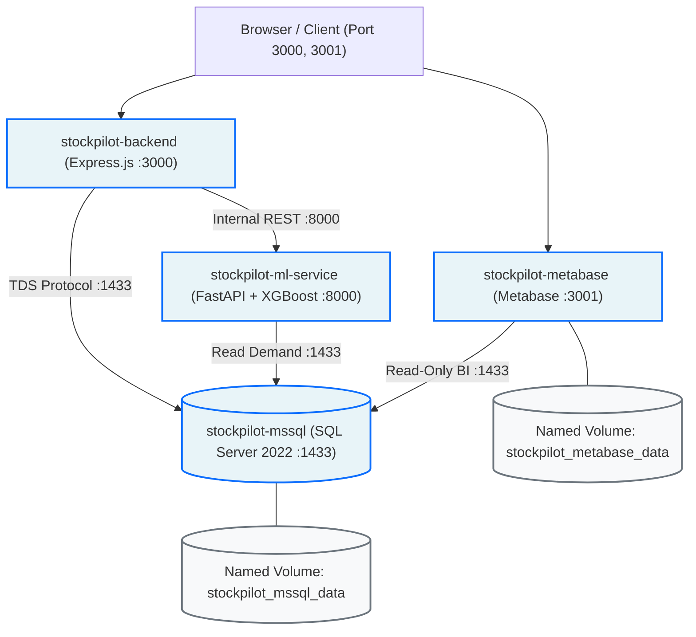

# StockPilot — Multi-Container Docker Deployment & Operations Guide

## 1. System Architecture & Container Topology

StockPilot is orchestrated as a 4-tier microservice architecture connected over an isolated Docker bridge network (`stockpilot-net`).



---

## 2. Container Inventory & Specifications

| Container Name | Technology | Ports | Healthcheck Probe | Volume Mount |
|---|---|---|---|---|
| `stockpilot-mssql` | Microsoft SQL Server 2022 (Linux) | `1433:1433` | `/opt/mssql-tools18/bin/sqlcmd` | `stockpilot_mssql_data:/var/opt/mssql` |
| `stockpilot-ml-service` | Python 3.11, FastAPI, XGBoost | `8000:8000` | `curl -f http://localhost:8000/health` | None (Stateless inference) |
| `stockpilot-backend` | Node.js 20 LTS, Express, Vanilla JS | `3000:3000` | `wget --spider http://localhost:3000/api/health` | None (Application code) |
| `stockpilot-metabase` | Metabase v0.50.32 | `3001:3000` | `curl --fail http://localhost:3000/api/health` | `stockpilot_metabase_data:/metabase.db` |

---

## 3. Dependency & Readiness Order

The containers start and coordinate using Docker Compose `depends_on` conditions with active health checks:

1. **`stockpilot-mssql` starts first.** It runs an internal health probe testing SQL Server readiness via `SELECT 1`.
2. **`stockpilot-ml-service` waits** until `stockpilot-mssql` is `service_healthy`. On startup, it loads the trained XGBoost model and preprocessor artifacts into memory and serves `GET /health`.
3. **`stockpilot-backend` waits** until both `stockpilot-mssql` and `stockpilot-ml-service` are `service_healthy`. It initializes the database connection pool, validates database connectivity, and opens HTTP port 3000.
4. **`stockpilot-metabase` waits** until `stockpilot-mssql` is `service_healthy`, ensuring the database engine is accessible before mounting the BI connection.

---

## 4. Minimum Hardware & Resource Recommendations

- **CPU:** Minimum 2 cores (Recommended: 4 cores for concurrent ML inference and Metabase analytics).
- **RAM:** Minimum 4.0 GB total system memory allocated to Docker Desktop / Engine.
  - SQL Server: ~1.5 GB
  - Metabase: ~1.0 GB
  - ML Microservice: ~500 MB
  - Node Backend: ~250 MB
- **Disk:** At least 10 GB of free space for container images, persistent database storage, and model artifacts.

---

## 5. Operations & Runbook

### A. First-Time Setup & Startup
```powershell
# 1. Ensure .env is populated with strong passwords
cp .env.example .env

# 2. Build and start all 4 services in detached mode
docker compose up -d --build

# 3. Monitor container health and startup logs
docker compose ps
docker compose logs -f
```

### B. Graceful Shutdown & Restart
```powershell
# Stop all containers preserving volume data
docker compose stop

# Resume containers
docker compose start

# Full teardown (preserves persistent volumes)
docker compose down

# Teardown with volume removal (destructive: wipes database)
docker compose down -v
```

### C. Database Backup & Disaster Recovery
```powershell
# Execute native SQL Server backup inside the container
docker exec -t stockpilot-mssql /opt/mssql-tools18/bin/sqlcmd \
  -S localhost -U sa -P 'YourStrong@Passw0rd123!' -C \
  -Q "BACKUP DATABASE [StockPilotDB] TO DISK = '/var/opt/mssql/backup_StockPilotDB.bak' WITH FORMAT, INIT;"

# Copy backup file to host machine
docker cp stockpilot-mssql:/var/opt/mssql/backup_StockPilotDB.bak ./backup_StockPilotDB.bak
```

### D. Security & Non-Root Principles
- Both `stockpilot-backend` and `stockpilot-ml-service` drop administrative permissions and run as an unprivileged system user (`stockpilot`, UID `1000`).
- Credentials are not hardcoded inside image layers; configuration is injected strictly through environment variables.
- Inter-service communication (`stockpilot-backend` to `stockpilot-ml-service`) traverses the internal `stockpilot-net` bridge network.
