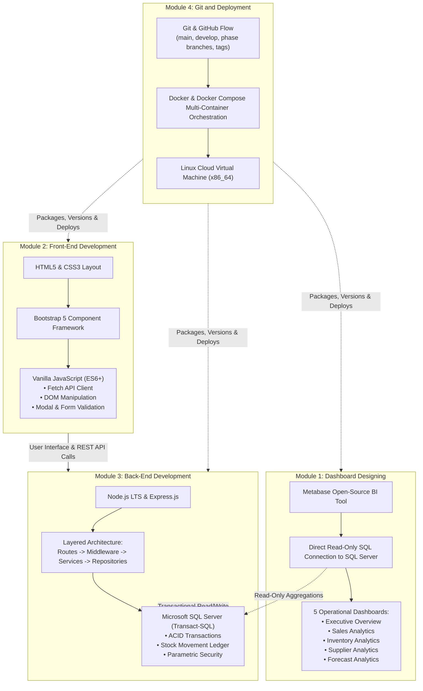

# StockPilot — TPDS-III Course Syllabus Mapping

**Document Version:** 1.0  
**Phase:** Phase 0 (Baseline Freeze)  
**Academic Program:** TPDS-III  
**Purpose:** Formal academic mapping of course syllabus modules to concrete architectural deliverables, codebase structures, and verification evidence.

---

## 1. Syllabus Overview & Architecture Alignment

StockPilot is structured specifically to provide clear, verifiable, and non-trivial demonstration of all four core modules of the **TPDS-III** curriculum. 

---

## 2. Four-Module Deliverables Mapping Table

| Syllabus Module | Syllabus Concepts & Requirements | StockPilot Concrete Deliverables | Codebase Paths / Target Artifacts | Verification Evidence |
|---|---|---|---|---|
| **Module 1: Dashboard Designing** | • Connecting to relational data sources • Creating visual charts, bars, lines, gauges • Applying filters (date ranges, categories) • Building interactive business dashboards • Dashboard deployment and access control | **Metabase Business Intelligence Suite** • Direct connection to `StockPilotDB` via dedicated read-only account • Executive Overview Dashboard • Sales Trend & Category Performance Dashboard • Inventory Health & Aging Dashboard • Supplier Fulfillment & Lead-Time Variance Dashboard • Forecast Accuracy & Replenishment Pipeline Dashboard | `metabase/` `docs/dashboards/` `sql/bi-queries/` `sql/bi-views/` | • Dashboard screenshots with active filters • SQL source query files matching KPI totals • Database reconciliation test scripts • Live Metabase dashboard presentation |
| **Module 2: Front-End Development** | • Responsive web design for mobile/tablet/desktop • Modern HTML5 semantic structures • CSS3 styling and grid layouts • Bootstrap 5 components (navbars, cards, modals, alerts, tables) • JavaScript DOM manipulation, event handling, and asynchronous API integration (Fetch API) | **Responsive Web Client Shell & Workflow Screens** • Universal responsive navigation bar with RBAC-aware menu items • Product catalog grid with search, filter, and modal edit dialogs • Point-of-Sale interface with dynamic multi-line item entry and live subtotal calculations • Purchase Order lifecycle interface with partial receiving controls • Inventory ledger viewer and low-stock indicator widgets • Forecast review and recommendation authorization UI | `public/` `public/css/` `public/js/` `public/screens/` `views/` | • Cross-device screenshots (desktop, tablet, mobile) • Browser interaction test scripts • Form validation and error state captures • Network tab inspection proving client Fetch calls |
| **Module 3: Back-End Development** | • Web server setup and HTTP protocol handling • RESTful API architecture (GET, POST, PUT, DELETE) • Relational database management with SQL Server • SQL queries, joins, constraints, and stored procedures/transactions • Middleware design (authentication, authorization, error handling, logging) | **Node.js & Express RESTful Core Platform** • Express server with structured routes, controllers, services, repositories • Parameterized SQL queries using `mssql` connection pool • Multi-statement ACID transactions for sales, stock deductions, and PO receiving • Immutable stock movement ledger • Role-Based Access Control (Admin, Manager, Staff) with bcrypt hashing and secure session cookies • Request validation middleware and centralized exception handling | `src/controllers/` `src/services/` `src/repositories/` `src/middleware/` `src/routes/` `src/db/` `sql/migrations/` `sql/seeds/` | • Supertest API automated test suites • SQL Server transactional rollback verification scripts • Concurrency oversell test logs • Postman collection & OpenAPI / Swagger spec |
| **Module 4: Git and Deployment** | • Version control fundamentals (init, commit, push, pull, branch, merge, tag) • Strict collaborative branching strategies • Containerization with Dockerfiles • Multi-container orchestration using Docker Compose • Deployment to cloud Linux environments | **Enterprise Git Workflow & Docker Infrastructure** • Phase-wise branch flow (`main`, `develop`, `phase/NN-*`) • Non-fast-forward merge strategy and release tagging (`phase-NN-complete`) • Multi-stage Dockerfile for Node.js Express service • Dockerfile for Python ML forecasting service • `docker-compose.yml` orchestrating App, SQL Server, Metabase, and ML service on private network • Persistent volume management for database survival • Deployment runbooks for Linux host | `.git/` `Dockerfile` `docker-compose.yml` `deploy/` `docs/deployment-guide.md` `docs/phase-reports/` | • Complete Git commit and tag tree on GitHub • Verified clean `docker compose up` run log • Persistent volume restart test verification • Public / cloud deployment URL or demonstration video |

---

## 3. Specialized Enhancement: ML Decision-Support Service

While the four modules above fulfill and exceed the core TPDS-III requirements, StockPilot incorporates a **Machine Learning Demand Forecasting Service** as an advanced decision-support capability.

- **Role:** An isolated, containerized Python/FastAPI microservice executing offline training and scheduled inference using an **XGBoost Regressor (`XGBRegressor`)**.
- **Architectural Scope:** The ML service does not replace the primary Express backend or SQL Server database. It reads historical daily demand, computes recursive multi-step forecasts, and estimates safety-stock buffers based on empirical error distributions.
- **Resilience Policy:** The core inventory system remains fully functional if the ML service is offline. A deterministic moving-average and rule-based reorder point fallback activates automatically, preserving operational continuity.
