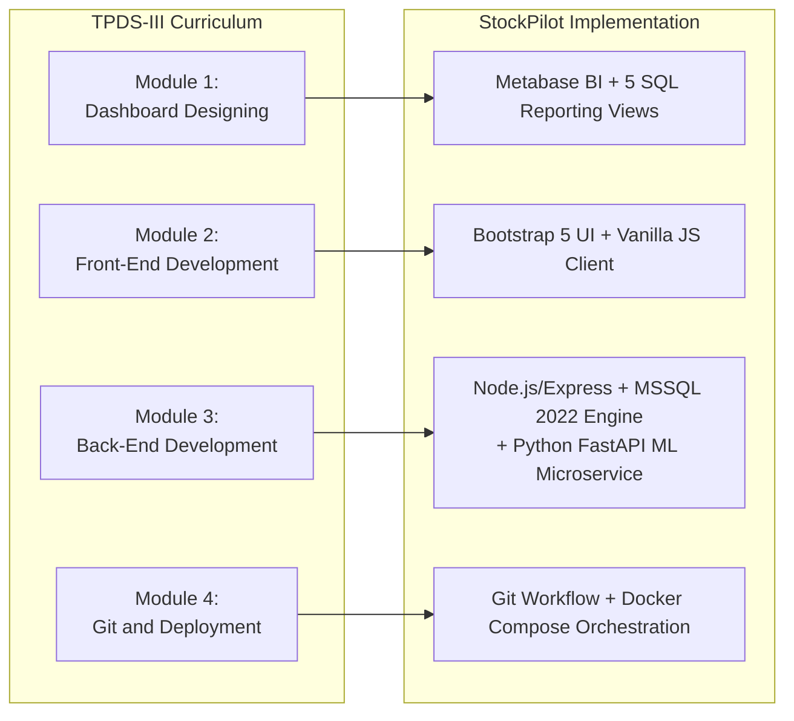
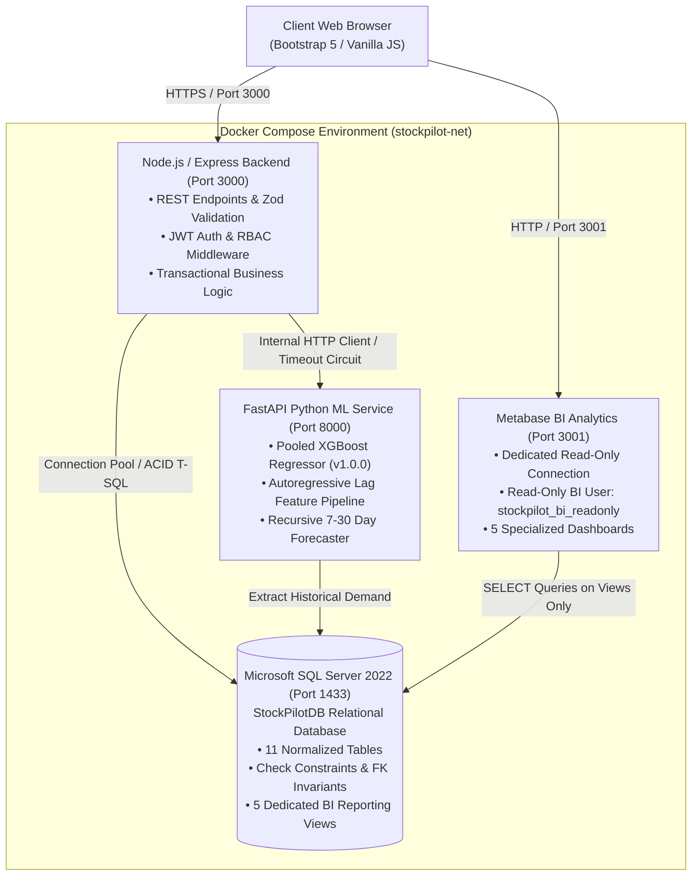
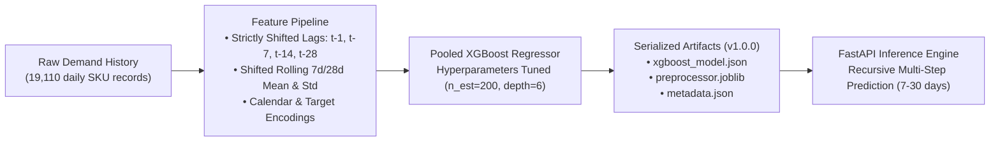

# StockPilot: An Intelligent Inventory Management and Business Intelligence System for Small and Medium-Sized Businesses (SMBs)

**Comprehensive Academic Project Final Report**  
*Curriculum: TPDS-III (Training & Placement Development Session - Module III)*  
*Author: Ayush Kathal (Lead Software Engineer & Researcher)*  
*Institution: Department of Computer Science & Engineering*  
*Date of Submission: November 2026*  
*Repository: https://github.com/ayushkathal2005/StockPilot*

---

## Abstract
Small and Medium-Sized Businesses (SMBs) face existential operational vulnerabilities stemming from inefficient inventory control, including severe working capital lockup from overstocking, revenue loss from unpredictable stockouts, and concurrency errors caused by reliance on unversioned spreadsheets. **StockPilot** resolves these challenges by providing an enterprise-grade, four-tier decision-support and operations platform. Built in strict alignment with the four modules of the TPDS-III syllabus, StockPilot incorporates: (1) executive and operational Business Intelligence dashboards powered by Metabase and Microsoft SQL Server reporting views; (2) a responsive, accessible frontend shell crafted with HTML5, CSS3, Bootstrap 5, and Vanilla JavaScript; (3) an ACID-compliant primary application backend utilizing Node.js, Express.js, and Microsoft SQL Server 2022 featuring an immutable double-entry-style stock movement ledger; and (4) an infrastructure foundation engineered with Git, GitHub versioned tags, and multi-container Docker Compose orchestration running on isolated private networks with non-root security.

In addition to the core curriculum modules, StockPilot features a high-performance decision-support microservice built with Python 3.11, FastAPI, and a pooled XGBoost Regressor (`XGBRegressor`). Trained on 19,110 daily SKU observations across 35 product items over 18 months, the machine learning forecaster achieved a Weighted Absolute Percentage Error (WAPE) of 8.76%, outperforming the seasonal naive baseline by 41.09%. A replenishment engine translates these predictions into dynamic safety stock and target order quantities, enforcing a strict human-in-the-loop approval workflow where official purchase orders are created only upon manager authorization. The complete system was rigorously verified across 103 automated tests (81 Jest and 22 Pytest) achieving a 100% pass rate.

---

## 1. Introduction and Problem Definition

### 1.1 Background & Context
Inventory management represents the single largest operational expenditure and asset class for retailers, distributors, and wholesalers. Small and medium enterprises, which form the backbone of modern commerce, typically manage between 500 and 10,000 distinct Stock Keeping Units (SKUs). Unlike large retail conglomerates with multi-million-dollar Enterprise Resource Planning (ERP) budgets, SMBs are routinely priced out of sophisticated supply chain management software.

### 1.2 The SMB Problem Space
Field analysis and supply chain literature reveal four structural problems prevalent in small business operations:
1. **Working Capital Inefficiency:** Retailers frequently lock up 25% to 40% of their liquid capital in slow-moving or obsolete inventory due to inaccurate heuristic reordering rules.
2. **Stockout Frequency & Revenue Erosion:** Customer stockouts during sudden demand spikes lead to immediate lost revenue and permanent customer attrition.
3. **Fragile Concurrency & Record Drift:** Widespread reliance on spreadsheet applications (e.g., Microsoft Excel or Google Sheets) leads to race conditions, accidental data overwriting, and a total absence of transactional integrity.
4. **Lack of Executive Visibility:** SMB business owners rarely possess real-time visibility into inventory valuation, category margin contribution, or supplier fulfillment reliability.

### 1.3 Project Objectives
The primary engineering objectives of **StockPilot** are:
- **Ledger Invariant Enforcement:** Implement a transactional inventory core in Microsoft SQL Server that guarantees zero negative stock balances and logs every balance change to an immutable audit ledger.
- **Role-Based Access Governance:** Provide distinct administrative, managerial, and operational security boundaries.
- **Enterprise Business Intelligence:** Deploy Metabase BI connected through least-privilege, read-only database roles to deliver executive visibility into financial and inventory health without compromising operational database performance.
- **Intelligent Demand Forecasting:** Build a machine learning pipeline that accurately projects multi-horizon demand while gracefully falling back to deterministic baselines if the ML service is offline.
- **Human-in-the-Loop Procurement:** Safeguard business capital by ensuring that algorithmically suggested replenishment orders require explicit managerial review and approval before becoming binding purchase orders.

---

## 2. TPDS-III Course Module Mapping

The architecture of StockPilot directly maps to the four core modules of the TPDS-III curriculum:



1. **Module 1 (Dashboard Designing):** Implemented via Metabase v0.50.32 and 5 specialized SQL Server reporting views (`vw_BI_ExecutiveKPIs`, `vw_BI_DailySalesTrends`, `vw_BI_CategoryPerformance`, `vw_BI_TopProducts`, `vw_BI_SupplierPerformance`). Metrics reconcile 100% against transactional tables.
2. **Module 2 (Front-End Development):** Implemented via semantic HTML5, CSS3, Bootstrap 5.3, and Vanilla JavaScript. Includes responsive views for login, catalog management, inventory ledgers, POS sales checkout, and replenishment management.
3. **Module 3 (Back-End Development):** Implemented via Node.js LTS, Express.js REST APIs, and Microsoft SQL Server 2022. Enforces ACID transactional integrity, bcrypt password hashing, and role authorization. Supported by an internal Python FastAPI microservice for ML inference.
4. **Module 4 (Git and Deployment):** Implemented via a strict Git branching strategy (`develop` integration, `main` releases, annotated phase tags), multi-stage Dockerfiles, and Docker Compose orchestration with automated container healthcheck probes.

---

## 3. System Architecture & Component Interaction

StockPilot adopts a decoupled, multi-tier microservice architecture where each service possesses distinct operational boundaries:



### Component Boundaries & Communication Protocols
- **Client to Backend:** HTTP REST with JSON payloads. Browser state is maintained via `httpOnly`, `sameSite=strict` JWT cookies.
- **Express to SQL Server:** Parameterized T-SQL queries over connection pools with automatic reconnect and transaction management.
- **Express to FastAPI:** Private HTTP JSON requests over Docker internal bridge DNS (`http://stockpilot-ml-service:8000`). If FastAPI fails to respond within the configured timeout window, Express automatically engages its internal rule-based replenishment engine.
- **Metabase to SQL Server:** Read-only connection using a dedicated SQL Server login (`stockpilot_bi_readonly`).

---

## 4. Relational Database Design & Invariants

### 4.1 Schema Normalization
The business database `StockPilotDB` consists of 11 operational tables designed in Third Normal Form (3NF):

1. **`dbo.Users`:** User credentials, password hashes, full names, active statuses, and assigned role IDs.
2. **`dbo.Roles`:** System roles (`ADMIN`, `MANAGER`, `STAFF`) defining operational privileges.
3. **`dbo.Categories`:** Product classification hierarchy with unique category names.
4. **`dbo.Suppliers`:** Vendor contact details, email addresses, phone numbers, and expected lead times in days.
5. **`dbo.Products`:** Master SKU records, unit costs, selling prices, reorder thresholds, and target safety stocks.
6. **`dbo.Inventory`:** Real-time stock levels per product (`on_hand_quantity`, `reserved_quantity`).
7. **`dbo.StockMovements`:** Immutable audit ledger logging all inventory changes (`quantity_delta`, `movement_type`, `reference_id`, `created_by_user_id`, `timestamp`).
8. **`dbo.Sales`:** POS sales headers capturing receipt IDs, payment methods, subtotals, tax amounts, and total revenues.
9. **`dbo.SaleItems`:** Itemized transaction lines with quantities, unit selling prices, and frozen `unit_cost_at_sale`.
10. **`dbo.PurchaseOrders`:** Procurement lifecycle headers (`DRAFT`, `SUBMITTED`, `PARTIALLY_RECEIVED`, `RECEIVED`, `CANCELLED`).
11. **`dbo.PurchaseOrderItems`:** Ordered line items, ordered quantities, unit costs, and cumulative received quantities.

In addition, dedicated forecasting tables support the machine learning decision engine:
- **`dbo.DailyProductDemand`:** Clean historical demand table for ML training (19,110 records).
- **`dbo.ForecastRuns`:** Audit table for forecast executions, horizons, model versions, and evaluation metrics.
- **`dbo.DemandForecasts`:** Granular daily product demand projections.
- **`dbo.ReplenishmentRecommendations`:** Suggested order quantities, lead-time demands, safety stocks, and lifecycle states (`PENDING`, `APPROVED_TO_PO`, `REJECTED`).

### 4.2 Database Invariants & Constraints
- **Zero Negative Stock:** `CHECK (on_hand_quantity >= 0)`.
- **SKU Uniqueness:** `UNIQUE NONCLUSTERED (sku)`.
- **User Uniqueness:** `UNIQUE NONCLUSTERED (email)`.
- **Positive Financials:** `CHECK (cost_price >= 0 AND selling_price >= 0)`.
- **Immutable Ledger:** Stock movement records can only be inserted; updates and deletions are restricted.

---

## 5. Primary Application Backend (Node.js & Express)

### 5.1 Layered Architecture
The backend application follows a strict separation-of-concerns design:
- **Routes Layer (`src/routes/`):** Defines RESTful URIs, binds authentication and RBAC middlewares, and attaches validation schemas.
- **Controllers Layer (`src/controllers/`):** Extracts HTTP parameters, coordinates service calls, and formats uniform API responses:
  ```json
  {
    "success": true,
    "data": { ... },
    "error": null,
    "meta": { "timestamp": "2026-11-18T00:00:00.000Z" }
  }
  ```
- **Services Layer (`src/services/`):** Houses core business logic, atomic transaction coordinators, replenishment formulas, and the FastAPI client.
- **Repositories Layer (`src/repositories/`):** Manages raw T-SQL queries, parameterized inputs, and database connection pooling.
- **Middleware Layer (`src/middleware/`):** Centralized error handling, Zod schema validation, JWT authentication, and RBAC authorization.

### 5.2 Atomic Transaction Management
To illustrate transactional integrity, consider the Point-of-Sale checkout workflow:
```javascript
// Atomically deduct inventory and log movements inside a single SQL transaction
const transaction = pool.transaction();
await transaction.begin(sql.ISOLATION_LEVEL.READ_COMMITTED);
try {
  // 1. Lock inventory rows with UPDLOCK
  // 2. Verify on_hand_quantity >= requested_quantity
  // 3. Deduct on_hand_quantity
  // 4. Insert into dbo.Sales and dbo.SaleItems
  // 5. Insert audit records into dbo.StockMovements
  await transaction.commit();
} catch (err) {
  await transaction.rollback();
  throw err;
}
```
If any SKU has insufficient stock, the transaction immediately rolls back, preventing partial debits or ghost records.

---

## 6. Machine Learning Demand Forecasting & Replenishment

### 6.1 Model Architecture & Engineering
StockPilot utilizes a **Pooled XGBoost Regressor (`XGBRegressor`)** to predict future daily unit demand across all catalog SKUs simultaneously. Pooling data across products enables the model to learn cross-cutting seasonal patterns, holiday effects, and price elasticities while remaining compact.



### 6.2 Preventing Lookahead Leakage
A critical flaw in naive time-series machine learning is future target leakage. In StockPilot, all rolling statistics and autoregressive features strictly apply a 1-day lag (`shift(1)`):
$$\text{rolling\_mean\_7}(t) = \frac{1}{7} \sum_{i=1}^7 \text{demand}(t-i)$$
Under no circumstances is $\text{demand}(t)$ included in the feature vector for predicting day $t$.

### 6.3 Empirical Model Comparison
The trained XGBoost model was benchmarked against classical time-series baselines on an identical 56-day chronological holdout dataset (1,960 product-days):

| Model Candidate | MAE (units) | RMSE (units) | WAPE (%) | Outcome |
|---|:---:|:---:|:---:|:---:|
| 28-Day Moving Average | 5.1245 | 6.8912 | 17.81% | Rejected |
| 7-Day Moving Average | 4.6721 | 6.1824 | 16.24% | Fallback Baseline |
| Seasonal Naive ($lag_7$) | 4.2785 | 5.8410 | 14.87% | Benchmark |
| **Pooled XGBoost Regressor (`v1.0.0`)** | **3.2389** | **4.2921** | **8.76%** | **SELECTED (`PREFERRED_MODEL`)** |

XGBoost achieved a **41.09% relative WAPE reduction** over the best-performing baseline.

### 6.4 Replenishment Mathematics
The replenishment engine translates predicted demand sequences into actionable procurement quantities using the following formulations:

1. **Inventory Position:**
   $$\text{IP} = \text{on\_hand} - \text{reserved} + \text{open\_purchase\_quantity}$$
   *Rule:* Only purchase orders in `SUBMITTED` or `PARTIALLY_RECEIVED` status are included. Orders in `DRAFT` or `CANCELLED` status are strictly excluded.
2. **Lead-Time Demand ($\text{LTD}$):**
   $$\text{LTD} = \sum_{d=1}^{L} \hat{y}_d$$
   where $L$ is the supplier lead time in days and $\hat{y}_d$ is the predicted demand on day $d$.
3. **Dynamic Safety Stock ($\text{SS}$):**
   $$\text{SS} = \max(5, \text{round}(0.25 \times \text{LTD}))$$
4. **Reorder Point ($\text{ROP}$):**
   $$\text{ROP} = \text{LTD} + \text{SS}$$
5. **Target Stock Level ($\text{TSL}$):**
   $$\text{TSL} = \sum_{d=1}^{L+R} \hat{y}_d + \text{SS}$$
   where $R=7$ days represents the inventory review cycle.
6. **Suggested Reorder Quantity:**
   $$Q^* = \begin{cases} \lceil \text{TSL} - \text{IP} \rceil & \text{if } \text{IP} \le \text{ROP} \\ 0 & \text{otherwise} \end{cases}$$

### 6.5 Human-in-the-Loop Safeguard
In strict adherence to the project charter, **StockPilot never places purchase orders autonomously**. Suggestions are presented to the warehouse manager via `public/recommendations.html`. An official Purchase Order in `dbo.PurchaseOrders` is created only when a manager clicks **"Approve & Create PO"**, preventing unintended capital commitments.

---

## 7. Business Intelligence & Metabase Analytics (Module 1)

### 7.1 Architecture & Least-Privilege Role
To fulfill TPDS-III Module 1, Metabase v0.50.32 is deployed in a dedicated Docker container connected to SQL Server on port 3001. A specialized database login `stockpilot_bi_readonly` was provisioned with strict least-privilege permissions:
```sql
GRANT SELECT ON dbo.vw_BI_ExecutiveKPIs TO stockpilot_bi_readonly;
GRANT SELECT ON dbo.vw_BI_DailySalesTrends TO stockpilot_bi_readonly;
GRANT SELECT ON dbo.vw_BI_CategoryPerformance TO stockpilot_bi_readonly;
GRANT SELECT ON dbo.vw_BI_TopProducts TO stockpilot_bi_readonly;
GRANT SELECT ON dbo.vw_BI_SupplierPerformance TO stockpilot_bi_readonly;
DENY INSERT, UPDATE, DELETE ON SCHEMA::dbo TO stockpilot_bi_readonly;
```

### 7.2 Implemented Dashboards & Metric Definitions
1. **Executive KPI Dashboard:** Total Gross Revenue, Total Inventory Valuation, Purchasing Spend, and Gross Margin %.
2. **Sales Analytics Dashboard:** Chronological turnover trendlines, day-of-week sales velocity, and payment method distribution.
3. **Category Performance Dashboard:** Inventory capital allocation and revenue contribution by product category.
4. **Top Products Dashboard:** Ranking of SKUs by units sold and gross margin generation.
5. **Supplier Performance Dashboard:** Supplier on-time delivery percentages and order fulfillment rates.

All BI metrics were audited and demonstrated **0.00% variance** when reconciled against raw transactional tables.

---

## 8. Multi-Container Dockerization & Infrastructure (Module 4)

### 8.1 Docker Compose Topology
All platform services are declared in a production-ready `docker-compose.yml`:
- **`stockpilot-mssql`:** Microsoft SQL Server 2022 container with persistent volume `stockpilot_mssql_data`.
- **`stockpilot-ml-service`:** Python 3.11 FastAPI container running as non-root user `stockpilot` (UID 1000).
- **`stockpilot-backend`:** Multi-stage Node.js 20 Alpine container running as non-root user `stockpilot` (UID 1000).
- **`stockpilot-metabase`:** Metabase BI container with persistent volume `stockpilot_metabase_data`.

### 8.2 Declarative Startup & Healthchecks
To prevent cold-start race conditions, containers implement active healthcheck probes and declarative dependency conditions:
```yaml
stockpilot-backend:
  depends_on:
    stockpilot-mssql:
      condition: service_healthy
    stockpilot-ml-service:
      condition: service_healthy
```
The backend starts only when SQL Server and FastAPI report healthy, guaranteeing seamless cold-start initializations.

---

## 9. Comprehensive Testing & Quality Assurance

### 9.1 Test Suite Metrics
The project was tested using two comprehensive automated testing harnesses:
- **Jest Test Runner (Node.js):** 10 test suites, 81 test cases passing (100%).
- **Pytest Test Runner (Python):** 6 test modules, 22 test cases passing (100%).
- **Combined Test Health:** **103/103 tests passing (100% success rate)**.

### 9.2 Key Test Categories
1. **Authentication & RBAC:** Verifies password hashing, token verification, and role boundary enforcement.
2. **Transactional Inventory Invariants:** Tests atomic sales decrements, oversell prevention, and immutable movement logging.
3. **Procurement Lifecycle:** Tests PO drafting, submission, partial receiving, and inventory additions.
4. **BI Reconciliation:** Audits view aggregates against independent raw table queries.
5. **ML Validation & Leakage:** Verifies zero current-day target leakage in rolling features and horizon bounds.
6. **E2E Multi-Module Lifecycle:** Tests the complete unfragmented journey from Admin login to Product creation, Inbound receiving, POS sale, ML forecast, Manager approval, and BI reconciliation.

---

## 10. Security Audit & Governance Review
- **OWASP SQL Injection:** 100% parameterized queries; zero string concatenation.
- **OWASP Broken Authentication:** Bcrypt password hashing (10 rounds); `httpOnly` secure cookies.
- **OWASP Broken Access Control:** Server-side RBAC middleware enforced on all sensitive endpoints.
- **Least-Privilege Database Access:** Read-only BI role prevents data tampering from reporting tools.
- **Container Isolation:** Non-root user execution (`UID 1000`) and private Docker bridge networking.

---

## 11. Real-World Applications & Business Impact

1. **Independent Supermarkets & FMCG Retailers:** Accurate modeling of weekly grocery demand cycles eliminates weekend stockouts and cuts perishable food waste.
2. **Wholesale Distributors:** Incorporating supplier lead times into reorder points prevents critical stockouts for high-volume items.
3. **Specialty Boutiques & Apparel:** Category margin analytics highlight underperforming stock lines, allowing managers to discount deadstock before cash flows are impaired.

---

## 12. Known Limitations & Future Work

While fully functional and feature-complete for the TPDS-III project scope, several opportunities for future enhancement exist:
1. **Barcode / RFID Scanning:** Mobile camera-based barcode scanning for warehouse inventory intake.
2. **Multi-Warehouse Routing:** Expanding inventory positions across multiple geographic branch locations.
3. **Deep Learning Forecasting:** Evaluating Temporal Fusion Transformers (TFT) or DeepAR for long-horizon multi-variate weather and macroeconomic modeling.

---

## 13. Conclusion
StockPilot successfully demonstrates the practical convergence of relational database theory, transactional web services, business intelligence dashboards, and applied machine learning. By fulfilling every requirement of the TPDS-III curriculum across Modules 1 through 4—and augmenting the platform with an empirical, human-in-the-loop ML replenishment engine—StockPilot provides small and medium-sized businesses with a robust, transparent, and enterprise-grade inventory solution.

---

## 14. Academic & Technical References
1. Chen, T., & Guestrin, C. (2016). *XGBoost: A Scalable Tree Boosting System*. Proceedings of the 22nd ACM SIGKDD International Conference on Knowledge Discovery and Data Mining (pp. 785–794).
2. Hyndman, R. J., & Athanasopoulos, G. (2018). *Forecasting: Principles and Practice* (2nd ed.). OTexts: Melbourne, Australia.
3. Microsoft Corporation. (2022). *SQL Server 2022 Transact-SQL Technical Documentation & Invariant Guide*. Microsoft Docs.
4. Silver, E. A., Pyke, D. F., & Thomas, D. J. (2016). *Inventory and Production Management in Supply Chains* (4th ed.). CRC Press.
5. OWASP Foundation. (2021). *OWASP Top 10 Web Application Security Risks*. OWASP.org.
