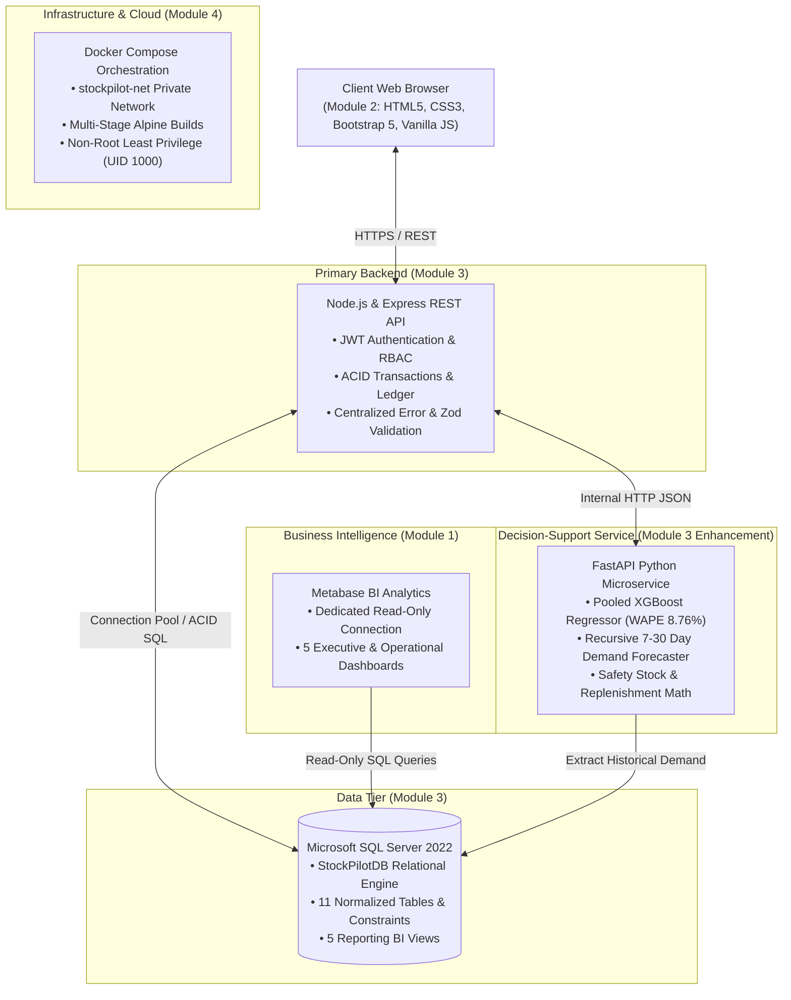

# StockPilot — Project Presentation Slide Deck (TPDS-III)

---

## Slide 1: Project Title
### **StockPilot: An Intelligent Inventory Management and Business Intelligence System for Small and Medium-Sized Businesses (SMBs)**
- **Course / Curriculum:** TPDS-III (Training & Placement Development Session - Module III)
- **Project Scope:** Enterprise Inventory Operations, ACID Transactional Ledger, Business Intelligence Dashboards, and Machine Learning Demand Forecasting
- **Candidate / Author:** Ayush Kathal (Lead Software Engineer & Researcher)
- **Academic Mentor / Guide:** TPDS Faculty Evaluation Committee
- **Repository:** `https://github.com/ayushkathal2005/StockPilot`

---

## Slide 2: Problem Statement
### **The SMB Inventory Crisis: Stockouts, Overstocking, and Inefficient Guesswork**
- **Critical Financial Challenges:**
  - **Capital Lockup:** Small and medium retailers tie up 25–40% of their working capital in dead or slow-moving stock.
  - **Stockouts & Lost Revenue:** Inability to anticipate demand leads to stockouts, lost sales, and customer churn during demand peaks.
  - **Fragile Spreadsheets & Legacy Tools:** Reliance on manual Excel sheets results in inventory drift, lack of auditability, and catastrophic concurrency collisions.
  - **Fragmented Decision-Making:** Procurement decisions are based on gut feeling rather than statistical lead-time demand calculations and historical sales trends.
- **Intended Users:** SMB retail store owners, warehouse managers, inventory controllers, and sales staff.

---

## Slide 3: Objectives and Scope
### **Engineered for Operational Integrity and Data-Driven Replenishment**
- **Key Objectives:**
  1. Deliver a single-source-of-truth transactional inventory ledger enforcing zero negative stock and immutable audit movements.
  2. Implement role-based access control (RBAC) separating Admin, Manager, and Staff operational responsibilities.
  3. Deploy enterprise business intelligence dashboards delivering executive visibility into gross margins, revenue trends, and inventory valuation.
  4. Provide machine learning demand forecasting with mathematical safety-stock replenishment calculations.
- **Included Scope:**
  - Multi-tier web application, Microsoft SQL Server 2022 relational engine, Metabase BI, Python FastAPI ML service, and Docker Compose orchestration.
- **Excluded Scope:**
  - Autonomous robot warehouse automation, multi-currency foreign exchange hedging, and external payment gateway banking settlement.

---

## Slide 4: Existing Solutions & Comparative Analysis
### **Why Existing SMB Tools Fall Short**

| Dimension | Legacy Desktop (Tally / Busy) | Generic Cloud SaaS | Excel / Google Sheets | **StockPilot (Proposed)** |
|---|---|---|---|---|
| **Inventory Ledger** | Basic batch accounting | High monthly subscription | Prone to corruption / zero ACID | **Strict transactional ledger with immutable movement logs** |
| **Data Ownership** | Proprietary silos | Vendor cloud lock-in | Unencrypted loose files | **Self-hosted / Private SQL Server 2022 data tier** |
| **Analytics & BI** | Static tabular text | Paywalled add-on | Manual chart maintenance | **Integrated Metabase BI with direct SQL views** |
| **Forecasting** | None / Manual min-max | Opaque black-box ML | None | **Transparent Pooled XGBoost Regressor with formula-based safety stock** |
| **Human Safeguards** | None | Auto-reorder without checks | Manual entry | **Manager-in-the-loop review & approval before PO creation** |

---

## Slide 5: Proposed System Architecture
### **Unified Four-Tier Architecture Aligned to TPDS-III Modules 1–4**

---

## Slide 6: Implementation & Live Demonstration
### **Core Modules & Production Features**
- **Module 1 (Dashboard Designing):**
  - Metabase dashboards powered by 5 purpose-built SQL Server views: Executive KPIs, Daily Sales Trends, Category Performance, Top Products, and Supplier Performance.
  - In-app analytics portal (`public/analytics.html`) providing cross-filtered KPI cards, gross profit margin audits, and supplier fulfillment rate gauges.
- **Module 2 (Front-End Development):**
  - Responsive Bootstrap 5 UI shell without heavyweight frameworks. Dynamic role-aware navigation, interactive POS sales terminal, purchase order manager, and modal dialogs.
- **Module 3 (Back-End Development):**
  - Node.js LTS + Express.js architecture with SQL Server connection pooling, bcrypt password hashing, JWT HTTP-only cookie sessions, and atomic transactional inventory decrements.
  - Python 3.11 FastAPI microservice delivering daily demand forecasts and replenishment recommendations.
- **Module 4 (Git & Deployment):**
  - Strict branch synchronization (`develop` $\to$ `main`), versioned phase tagging (`phase-00-complete` through `phase-09-complete`), and containerized Docker Compose orchestration.

---

## Slide 7: Testing, Results & Model Evaluation
### **Rigorous 100% Automated Verification Across 103 Test Cases**

- **Automated Test Results:**
  - **10/10 Jest Test Suites Passed (81/81 Tests):** Auth, RBAC, Catalog CRUD, Inventory Ledger Invariants, Sales POS Atomicity, PO Inbound Receiving, BI Security, Replenishment Logic, and End-to-End Multi-Module Lifecycle.
  - **6/6 Pytest Test Modules Passed (22/22 Tests):** Feature Engineering Zero-Leakage, Synthetic Generator Determinism, Validation Pipeline, Baselines, XGBoost Training, and FastAPI Contracts.
  - **Overall Automated Test Health: 103/103 Tests Passing (100%).**
- **Machine Learning Demand Forecasting Performance:**
  - **Trained Model:** Pooled XGBoost Regressor (`XGBRegressor`) trained on 19,110 daily SKU records.
  - **Evaluation Metrics:**
    - **MAE:** 3.2389 units/day
    - **RMSE:** 4.2921 units/day
    - **WAPE:** 0.0876 (8.76% weighted absolute error)
  - **Baseline Benchmark:** Seasonal Naive baseline yielded 14.87% WAPE $\to$ **XGBoost achieved a 41.09% error reduction**.

---

## Slide 8: Real-World Business Applications
### **Empowering SMB Retailers, Wholesalers, and Distributors**

1. **Independent Supermarkets & Grocery Retailers:**
   - Automatically forecast perishable and fast-moving consumer goods (FMCG) with day-of-week seasonality.
   - Prevent under-ordering before weekends and avoid over-ordering high-cost inventory.
2. **Hardware & Industrial Supply Distributors:**
   - Optimize purchase orders considering supplier lead times (e.g., 5–14 days) and minimum safety stock thresholds.
   - Streamline warehouse intake with partial purchase order receiving and immediate inventory availability.
3. **Apparel & Specialty Retail Boutiques:**
   - Track high-margin vs low-margin categories, identify deadstock, and monitor supplier fulfillment reliability through Metabase BI.

---

## Slide 9: Conclusion and Future Scope
### **Milestones Achieved & Strategic Roadmap**

- **Key Achievements:**
  - Successfully built, tested, and containerized an enterprise-grade inventory management and business intelligence platform fulfilling all four TPDS-III syllabus modules.
  - Solved the SMB inventory guessing problem by pairing an ACID transactional ledger with statistical ML replenishment.
  - Enforced strong governance: zero lookahead data leakage, parameterized SQL injection defense, least-privilege BI accounts, and human-in-the-loop purchase order authorizations.
- **Future Scope & Enhancements:**
  - Native barcode/QR code scanner integration for warehouse handhelds.
  - Multi-location warehouse routing and inter-warehouse stock transfer workflows.
  - Deep learning sequence models (Temporal Fusion Transformers) for multi-year weather/macroeconomic covariates.
- **References:**
  - Microsoft SQL Server 2022 Transact-SQL Technical Documentation.
  - Chen, T., & Guestrin, C. (2016). *XGBoost: A Scalable Tree Boosting System*. KDD '16.
  - Metabase Open Source Business Intelligence Manual (v0.50).
  - Docker Compose Specification (v2).
