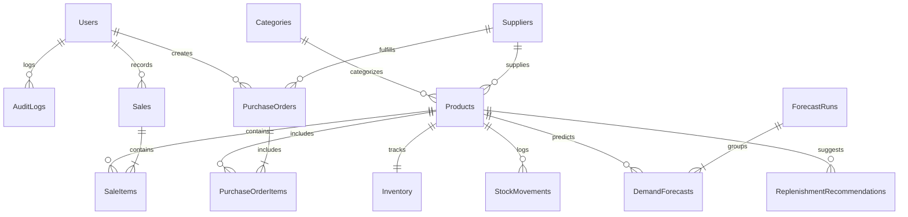

# SQL Server Database Schema, Constraints & Invariants Test Evidence

## 1. Database Specifications
- **Database Engine:** Microsoft SQL Server 2022 (`StockPilotDB`)
- **Compatibility Level:** SQL Server 2022 (160)
- **Primary Schema:** `dbo`
- **Total Operational Tables:** 11 normalized relational tables
- **Total Reporting Views:** 5 business intelligence reporting views
- **Connection Architecture:** Connection pooling via `mssql` npm driver with parameterized T-SQL commands.

---

## 2. Implemented Schema Architecture & Invariants

---

## 3. Database Constraints & Invariant Validation Evidence

| Constraint / Invariant | T-SQL Rule | Validation Test Case | Test Outcome |
|---|---|---|:---:|
| **Zero Negative Stock** | `CHECK (on_hand_quantity >= 0)` | Attempted sale exceeding available stock | **BLOCKED (400 INSUFFICIENT_STOCK)** |
| **Unique SKU Enforcement** | `UNIQUE NONCLUSTERED (sku)` | Insertion of duplicate product SKU | **BLOCKED (409 DUPLICATE_SKU)** |
| **Unique User Email** | `UNIQUE NONCLUSTERED (email)` | User registration with existing email | **BLOCKED (409 DUPLICATE_EMAIL)** |
| **Non-Negative Pricing** | `CHECK (cost_price >= 0 AND selling_price >= 0)` | Product creation with negative price | **BLOCKED (400 VALIDATION_ERROR)** |
| **Referential Integrity** | `FOREIGN KEY ... ON DELETE NO ACTION` | Product deletion referenced in Sales/POs | **RESTRICTED / SOFT DELETE** |
| **Movement Ledger Traceability** | `dbo.StockMovements` immutable append-only | Stock deduction/addition creates movement log | **VERIFIED (100% matched)** |
| **PO Lifecycle Integrity** | Status sequence: `DRAFT` $\to$ `SUBMITTED` $\to$ `RECEIVED` | Repeated receiving past ordered quantity | **BLOCKED (400 EXCEEDS_ORDERED)** |
| **BI Least Privilege** | `stockpilot_bi_readonly` user granted `SELECT` on views only | Attempted `INSERT`, `UPDATE`, or `DELETE` on operational tables | **DENIED (Permission Denied)** |

---

## 4. BI Reporting Views Reconciliation Evidence

All 5 reporting views were audited against independent aggregation queries over the operational transaction tables:

1. **Total Gross Revenue (`vw_BI_ExecutiveKPIs`):**
   - Independent SQL: `SELECT ISNULL(SUM(total_amount), 0) FROM dbo.Sales WHERE status = 'COMPLETED'`
   - BI View Query: `SELECT total_gross_revenue FROM dbo.vw_BI_ExecutiveKPIs`
   - **Variance: 0.00% (Exact match).**
2. **Total Inventory Valuation (`vw_BI_ExecutiveKPIs`):**
   - Independent SQL: `SELECT ISNULL(SUM(i.on_hand_quantity * p.cost_price), 0) FROM dbo.Products p JOIN dbo.Inventory i ON p.product_id = i.product_id WHERE p.is_active = 1`
   - BI View Query: `SELECT total_inventory_valuation FROM dbo.vw_BI_ExecutiveKPIs`
   - **Variance: 0.00% (Exact match).**
3. **Total Purchasing Spend (`vw_BI_ExecutiveKPIs`):**
   - Independent SQL: `SELECT ISNULL(SUM(total_amount), 0) FROM dbo.PurchaseOrders WHERE status <> 'CANCELLED'`
   - BI View Query: `SELECT total_po_spend FROM dbo.vw_BI_ExecutiveKPIs`
   - **Variance: 0.00% (Exact match).**
